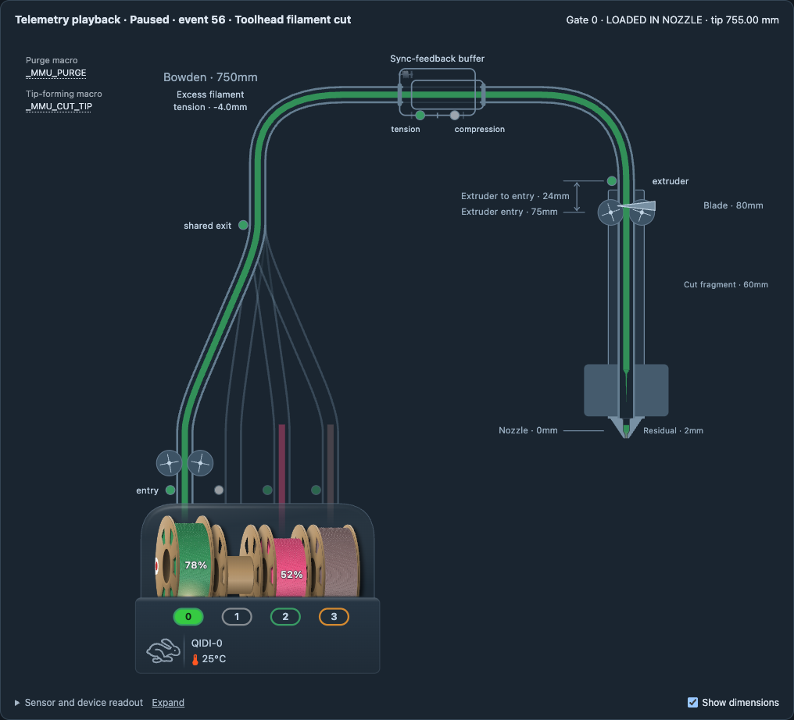
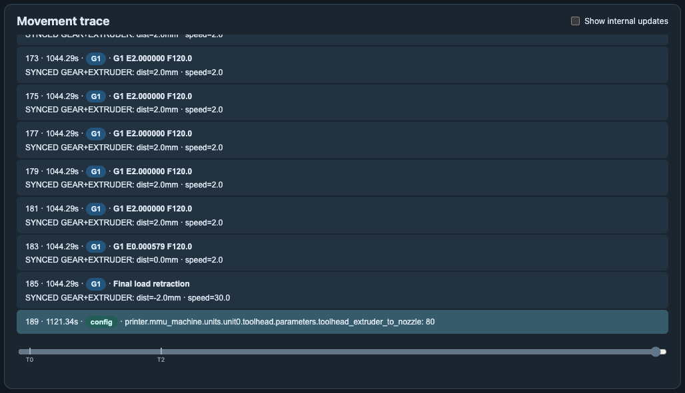

# Feature: Telemetry

## Concept

Telemetry is Happy Hare's record of *what the MMU actually did*: every filament
move with its distance and speed, every homing move and where it stopped, selector
and servo moves, extruder moves made by Happy Hare's own macros, the espooler
starting and stopping, tip cuts, gate changes, sensor readings and any setting you
changed while the machine was running. Each toolchange, load and unload is
bracketed by start and end markers so a recording can be read one operation at a time.

Three parts cooperate:

```text
Klipper (Happy Hare)  ->  Moonraker  ->  a viewer
  captures the events     relays them,    animates them live,
                          optionally      or replays a saved
                          records them    recording
```

The viewer is the [Happy Hare Console](Happy-Hare-Console.md): a browser app that
turns the stream into an animated picture of the filament path, with a step-by-step
trace underneath. Nothing about telemetry changes how Happy Hare moves filament -
it only observes.

Telemetry is useful in two ways:

- **Setting up and debugging configuration.** Replay a toolchange one step at a time and
  see where the filament tip really stopped compared with where your sensors,
  Bowden length, parking distance or cutter settings say it should be. A move that
  contradicts a sensor is flagged in the picture. You can change a setting from the
  same page and capture the toolchange again. See [Tuning](#tuning).
- **Sharing what happened.** A recording is a single file. Attach one to a bug
  report or Discord question and whoever helps can step through the very same
  toolchange rather than interpret a log.

Telemetry costs nothing while unused. Nothing is captured, and no timer or
subscription exists, until something asks for the stream, either a browser with the
Console open or a recording you start.

!!! note "A newer feature"
    Telemetry and the Console are new. They have been exercised extensively
    against the [simulator](Dev-Simulator.md); please report anything unexpected
    you see on a real printer.

## Moonraker Setup

Telemetry needs Happy Hare's `[mmu_telemetry]` Moonraker component. The installer
links it and adds this section to `moonraker.conf` for you:

```ini
[mmu_telemetry]
max_log_size: 10485760   # bytes per recording file before it rotates
log_backups: 5           # older files kept (.1 to .5)
```

- Moonraker **v0.9.0 or later** is required. If the component cannot load, Moonraker logs
  the reason and carries on running without it.
- On an existing installation, re-run the installer after updating and restart Klipper
  and Moonraker. A new installation also lists `moonraker` in the update manager's
  `managed_services`, so an update restarts it; an existing installation keeps its
  value, so restart Moonraker yourself after updating.
- No Klipper or Moonraker fork is needed.

Recordings are written to Moonraker's `logs` folder as `mmu-telemetry.jsonl`, with up to
five older files beside it (`mmu-telemetry.jsonl.1` to `.5`). Each file is plain text, one
record per line.

## Parameter Setup

There is a single option, in `mmu.cfg`'s `[mmu_parameters]` under the logging group. In
menuconfig it is **Motion telemetry recording after a restart** under **Logging**:

```ini
default_telemetry_mode: off     # off (default), on or toolchange
```

It sets the recording mode each time Klipper starts:

| Value | Meaning |
|---|---|
| `off` | Don't record. A browser can still watch live. |
| `on` | Record everything from startup. |
| `toolchange` | Record the first load, unload or toolchange after startup, then stop. |

Leave it `off` unless you want every restart to begin recording. Change the mode at any
time, without restarting, with [`MMU_TELEMETRY`](Reference-Commands.md#mmu_telemetry). The
option can only be set in `mmu.cfg`; it is not available through
[`MMU_TEST_CONFIG`](Reference-Commands.md#mmu_test_config).

## Commands

[`MMU_TELEMETRY`](Reference-Commands.md#mmu_telemetry) controls recording:

```text
MMU_TELEMETRY MODE=on           # record everything until switched off
MMU_TELEMETRY MODE=toolchange   # record the next load, unload or toolchange, then stop
MMU_TELEMETRY MODE=off          # stop recording
MMU_TELEMETRY                   # report the current mode and the startup default
```

How recording behaves:

- Every recording is one file. `MODE=on` starts a new file and rotates the previous one;
  each `MODE=toolchange` capture is its own file and uses one of the five slots.
- A `toolchange` capture begins when the command starts and ends with it, automatically.
  Arming it while a command is already running waits for the next command.
- Switching from `on` to `toolchange` closes the continuous file.
- Repeating the current mode changes nothing; it does not rotate the log.
- The mode lives in Klipper and is not saved across a restart; `default_telemetry_mode`
  decides what a restart begins with.
- When a file reaches `max_log_size` it rotates, but never in the middle of a move.
- If recording cannot continue (the disk fails, or writes fall too far behind) it stops with a
  Moonraker warning rather than slowing the printer or continuing with a damaged file.
  Recording is best effort and is not designed to survive a crash.

You do not need to record to a file to use the Console live. The Console can also
**Save telemetry** from the browser, which exports what it has captured so far (up to the
latest 7,000 events).

## Printer variables exposed

| Variable | Meaning |
|---|---|
| `printer.mmu.telemetry_mode` | `off`, `on` or `toolchange` |
| `printer.mmu.homing` | The endstops of a homing move in progress, or `None` |
| `printer.mmu.config_changes` | Settings changed at runtime that differ from your config files |

See the [Printer Variable Reference](Reference-Printer-Variables.md#telemetry-and-configuration-changes).

### In the Happy Hare Console

The Console's **Record to log** selector (Off, On, Next toolchange only) shows
`telemetry_mode` and sends `MMU_TELEMETRY` for you. It appears when connected to a printer,
not to the simulator, which has no recording to files.

## Tuning

### Check a new setup, one toolchange at a time

1. Open the [Happy Hare Console](Happy-Hare-Console.md#installing-it-on-your-printer) and
   choose **Telemetry stream** as the data source.
2. Ask for a recording of the next toolchange, either from the **Record to log** selector or
   with `MMU_TELEMETRY MODE=toolchange`. Live viewing does not need this; it is only for
   keeping a file.
3. Run the toolchange, for example `MMU_CHANGE_TOOL TOOL=1`. The Console animates it as it
   arrives.
4. Use **Previous toolchange** to return to its start, then step with the arrow keys, or press
   **Play** to watch it at the real feed speeds. Tick *Compress Bowden playback time* to skip
   most of a long Bowden move.

Step to the moves that matter and compare them with your expectations:

<p align="center">
  
</p>

- **Does the tip stop where you expect?** The trace gives every homing move and how far it
  travelled before the sensor triggered. A Bowden load that homed far sooner or later than
  `bowden_length` predicts is the clearest sign the calibration is off.
- **Warnings.** An amber **!** appears when a recorded move contradicts a sensor, for example
  filament sensed where the move says it cannot be. The warning box gives the sensor details.
  The blue **i** notes a selector move.
- **Cutting.** The blade, the cut fragment and the retract and push-back moves are drawn from
  your cutter settings. See [Tip Shaping: Toolhead
  Cutting](Macro-Toolhead-Tip-Cutting.md) and [Tip Shaping: MMU
  Cutting](Macro-Servo-Cutter.md).
- **Forming.** The cooling tube, ramming and dipping moves of
  [tip forming](Macro-Tip-Forming.md) appear as the extruder moves they make.

### Change a setting and try again

The **Runtime parameters** and **Toolhead config** panels send
[`MMU_TEST_CONFIG`](Reference-Commands.md#mmu_test_config) with Happy Hare's normal
validation, so the change takes effect immediately and appears in the trace as a **config**
step:

<p align="center">
  
</p>

Rerun the toolchange and compare. Runtime changes are temporary: when a value works, put it in
your `.cfg` files, or use the setting's normal `MMU_TEST_CONFIG` follow-up (see
[Operation](Operation.md)). `printer.mmu.config_changes` lists everything currently
different from your files.

### Debug a problem from a recording

1. Reproduce the problem with `MMU_TELEMETRY MODE=toolchange` (or `MODE=on` for something that
   takes several commands), then `MODE=off`.
2. Copy the file from Moonraker's `logs` folder to your computer.
3. In the Console choose **Load telemetry**. The recording opens paused at the start; nothing from
   the printer can change it.
4. Step through it. Each step shows what Happy Hare saw at that moment: the sensors, the
   filament position and the gate.

Send the same file to anyone helping you. Recordings contain Happy Hare's own events and
settings, not your G-code files.

## Troubleshooting

**`MMU_TELEMETRY` warns that Moonraker lacks the component.** Moonraker is older than v0.9.0,
or `[mmu_telemetry]` is missing from `moonraker.conf`. Re-run the installer and restart
Moonraker.

**Klipper warns, 30 seconds after starting, that Moonraker has not started the recording.**
`default_telemetry_mode` is `on` or `toolchange` but Moonraker is not running or did not load the
component. Check `moonraker.log`.

**A change of mode is reported as an error.** Telemetry failures cannot stop Klipper or a
print; read the message and try again once Moonraker is back.

**The Console shows nothing after a restart.** Choose **Telemetry stream** as the data source,
then run a command: the stream replays state when the page connects and animates what
follows.

**A recording stopped by itself.** Moonraker logs why (a write failure, or its queue filling).
Start it again with `MMU_TELEMETRY MODE=on`.

## See also

- [Happy Hare Console](Happy-Hare-Console.md) - installation and everything the viewer can do
- [The Simulator](Dev-Simulator.md) - try the Console without a printer
- [Printer Variable Reference](Reference-Printer-Variables.md)
- [`MMU_TELEMETRY`](Reference-Commands.md#mmu_telemetry)

---
