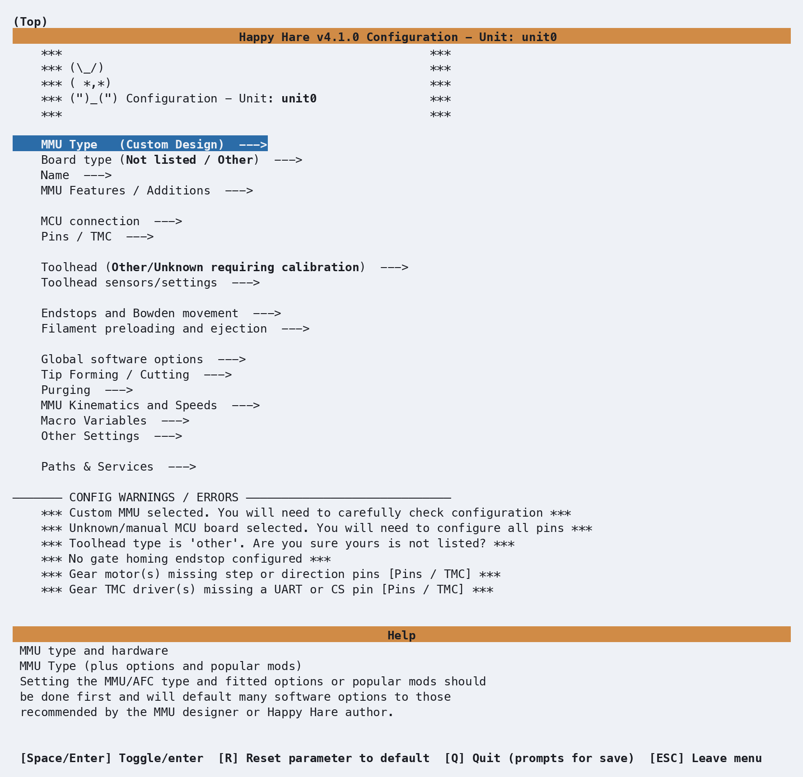

# Menuconfig

The Happy Hare v4 Installer and Configurator is a dynamic, `menuconfig` based 
configuration management system designed to streamline both initial installation
and ongoing maintenance of Happy Hare. It uses a structured, deterministic rules-based
workflow that exposes only the parameters and capabilities relevant to your specific 
MMU hardware and enabled features.

Where appropriate, the installer applies recommended defaults and sensible settings
across hardware definitions, GPIO assignments, and Happy Hare features. Options
not applicable to your configuration are suppressed and omitted from the generated files
in the `config/mmu/base/` folder.

This rules‑driven approach simplifies setup, reduces configuration errors and frustration, 
and provides a clear, maintainable foundation for upgrading, managing, and enabling Happy
Hare capabilities.

## Design Goal
The intention is for users to manage most configuration settings through the interactive
`menuconfig` installer (`./install.sh -i`), without needing to edit Happy Hare 
configuration files directly. The rules‑driven interface ensures that all configuration
 choices remain consistent with the selected MMU hardware and supported features.

## Direct Modification of Configuration Files
Direct modification of Happy Hare configuration files remains possible when required, 
with installer options available to control merge and overwrite behavior to suit your
preferred workflow. However, users are encouraged to rely primarily on the `menuconfig`
installer, which may require unlearning older habits of editing configuration files
directly.

All menuconfig selections are mastered and stored in the `Happy-Hare/.mmu_config`
settings file, with per-unit `.mmu_config_<name>` files in multi-unit mode. Copies
are maintained in `printer_data/config/mmu/` so they are included in popular
GitHub-based printer configuration backup mechanisms.

## Navigation


Navigation is intuitive and the same as any other `menuconfig` based interface.


| Key | Purpose |
| --- | ------- |
| **↑**   | move up |
| **↓**   | move down |
| **↵** or **space** | select a menu or option |
| **esc** | go back to the previous menu |
| **R**   | reset a setting to its default value (if available) |
| **Q**   | quit: **Y** saves and continues the install, **N** discards your changes and stops the install, **C** returns to `menuconfig` |

The top-down flow guides you through the process in a logical, step by step manner.
Depending on the MMU and selections you make, additional sub-menus and settings
will appear, enabling you to configure relevant settings for your MMU.

Any non modifiable settings that have been enabled based on your MMU design or due
to prior selection will be preselected with <br> `-*-` and will include the `(FIXED)`
designation  e.g. `-*- Has LEDs? (FIXED)`

**Config Warnings / Errors** are highlighted for you to review and correct before saving
and applying updates to your configuration.

## Unit names

The **Name** menu separates the **Klipper object name** used in configuration
from the **Display name** shown in the UI. The first unit defaults to `unit0`,
but you can choose another name during installation. In multi-unit mode, edit
object names in the shared **MMU units** list. See
[Naming an MMU unit](Installation.md#naming-an-mmu-unit).

## Managing Configuration Changes
When the `menuconfig` installer is launched after your initial setup and configuration,
you will be prompted to choose how it should apply and reconcile configuration changes with
locally applied settings. The installer supports two modes, _**Merge/Refresh**_ and
_**Replace**_:

```{.text .console-output}
You are running an interactive install with existing menuconfig ('.mmu_config').

Read carefully, you have two options:

1) Merge/Refresh (select 1) (Default upgrade path)
   This KEEPS the values you edited directly in your .cfg files (but not edited macro gcode).
   Before menuconfig opens, the simple settings your .cfg files hold are copied into menuconfig
   (you'll see the list and confirm), so menuconfig shows what you are actually running. Only
   the settings you then change in menuconfig are applied to your .cfg files, and new options
   are added.

2) Replace (select 2) (Recommended)
   This will OVERWRITE changes made directly to your .cfg files and create new default
   configuration based on choices made in menuconfig (which initializes to your previous config).
   This is RECOMMENDED if you make ALL your configuration changes via menuconfig. It is also
   useful if you get into trouble and want to reset your starting position or change MMU.

(Note that in all cases a BACKUP of your existing .cfg files will be made for reference)

Choose upgrade mode (1-2)?
```

1. **Merge/Refresh** (**Option 1 — Default upgrade path**)<br>
Merge/Refresh keeps the values in your existing Happy Hare `.cfg` files. Before
`menuconfig` opens, it lists the values from your `.cfg` files that `menuconfig` can
show and, if there are any, asks once whether to import them, so `menuconfig` shows what
you are actually running. Only the settings you change in `menuconfig` during that run are
applied to your `.cfg` files; every other option keeps its value, and new options required
by the current Happy Hare release are added. The exceptions are macro `gcode:` bodies, a
few structural options `menuconfig` always sets, and options the templates no longer
contain; see the [comparison](Installation.md#comparison).

2. **Replace** (**Option 2 — Recommended**)<br>
This is the recommended mode **_when all configuration changes are managed through menuconfig_**.
<br> The **Replace** mode **OVERWRITES** any local changes you have made directly to your 
Happy Hare `.cfg` files, resetting and regenerating a new configuration based solely on the 
selections made in `menuconfig`.  
<br>

Both modes end with a [summary of changes](Installation.md#summary-of-changes)
to your `.cfg` files, listing each value changed as `old -> new`. See
[Choosing an upgrade mode](Installation.md#choosing-an-upgrade-mode) for a detailed
comparison, the import prompt, and what can be imported.

Renaming, removing or reordering installed units requires **Replace (option 2)**.
Appending a unit also works in **Merge/Refresh**. See
[Multiple MMU Units](GettingStarted-Multi-Unit.md#unit-renaming) for the editor
controls, migration of saved state, and checks after changing the unit list.

!!! note "Notes"
    * `menuconfig` will never overwrite your existing configuration outright - it's copied
      to a timestamped backup directory before changes are applied (e.g.
      `mmu.old-20260807-102329`).
    * `./install.sh`, with or without `-i`, always checks GitHub first and updates Happy
      Hare to the latest version of the branch you are on. To prevent this, launch
      `./install.sh` with the `-z` flag to skip the update check.
    * Following a klipper/kalico upgrade or hard reset, you may need to run `./install.sh -f` 
      to restore all klipper/moonraker symbolic links to make sure everything is where it
      needs to be.
    * If you need to restore your `menuconfig` setup after re-imaging and restoring your
      configuration from a backup, run `./install.sh -i --last`. It copies `.mmu_config`,
      and on a multi-unit setup each `.mmu_config_<name>` file, from
      `~/printer_data/config/mmu/` back into your Happy-Hare directory. With a
      non-standard config directory, copy them yourself first, e.g.
      `cp ~/printer_data/config/mmu/.mmu_config* ~/Happy-Hare/`. See
      [Recovering Configuration from a Backup](#recovering-configuration-from-a-backup).
    * Merge/Refresh can import most simple values from your `.cfg` files into
      `menuconfig`, but not every hand edit. Before using *Replace* to reset your
      configuration baseline, run Merge/Refresh and accept the import, then re-apply
      each value it couldn't import: in `menuconfig` where it has a setting, otherwise
      by editing the `.cfg` file again after Replace (`./install.sh -i -v` lists them,
      with the reason for each). It's for this reason it's recommended to manage all configuration changes
      through `menuconfig` where possible.

## Recovering Configuration from a Backup

Every normal install preserves the existing `mmu` configuration directory as a
timestamped backup alongside it. If a configuration change goes wrong, run the
installer with `--prev` (or its short form, `-p`) to choose which saved state to
restore:

```{.text .console-command}
./install.sh -i --prev
```
```{.text .console-output}
Available MMU configuration backups:
  1) mmu (current config)
  2) mmu.old-20260831-115007 (2026-08-31 11:50:07)
  3) mmu.old-20260830-174053 (2026-08-30 17:40:53)

Choose backup to restore from (1-3)?
```

The current `mmu` directory is listed first when it contains a saved
`.mmu_config`; timestamped backups then appear from newest to oldest. Choose a
number to restore that directory and continue through the normal installation.
If you select a timestamped backup, the installer first preserves your current
`mmu` directory as another timestamped backup, then restores the selected
directory and recovers its `.mmu_config` files into the Happy Hare checkout.
This means the configuration you are replacing remains available if you need to
return to it.

Use `-i` with `--prev` when you want to review or adjust the recovered settings
in `menuconfig`, as shown above. Without `-i`, the installer applies the recovered
settings directly through its normal safe re-install/upgrade path.

For unattended recovery, `--last` (or `-l`) recovers the saved `.mmu_config`
without showing the selection menu. It uses the current installed configuration
when available, otherwise the newest timestamped backup. `--last` and `--prev`
cannot be used together, and neither recovery option can be combined with
uninstall mode.

---
