# Happy Hare Console

The Happy Hare Console is a browser app that shows your MMU working: the filament
path from spool to nozzle, drawn to your machine's own geometry and animated move by
move, with a step-by-step trace beside it. It follows the printer live, replays a
toolchange you have just run, or opens a recording someone saved earlier. You can also
drive the MMU from it: click a spool for a menu of load, unload, select and more.

!!! note "Console, Visualizer and the simulator's console"
    The app's own page title is **Happy Hare Visualizer**; this documentation calls it the
    Happy Hare Console. It is not the terminal that `make console` starts for the
    [simulator](Dev-Simulator.md) (though the simulator serves the app, see below), and not the
    "Console" card inside the app, which is a small command window.

It is fed by [telemetry](Feature-Telemetry.md). Read that page for how recordings are made and
for using the Console to [set up and debug](Feature-Telemetry.md#tuning) your configuration.

## Installing it on your printer

From the Happy Hare directory on the printer:

```bash
./install.sh -w
```

This adds an nginx site of its own, beside Mainsail or Fluidd, and prints its address - the first
free port from 8090, for example `http://<printer>:8090/`. The site serves the app from the Happy Hare
folder and passes the Moonraker connection through, exactly as Mainsail's site does, so nothing needs
adding to Moonraker's `cors_domains`.

- It asks before using `sudo`, tests the nginx configuration before reloading, and puts the previous
  configuration back if nginx rejects the change.
- Re-running it keeps the same port. Choose another with `VISUALIZER_PORT=9000 ./install.sh -w`, or point it at a
  Moonraker on another port with `UPSTREAM_PORT=7126 ./install.sh -w`.
- `./install.sh -u` removes the site along with Happy Hare. Updates need nothing extra: the app is part of the
  Happy Hare folder, so a normal update refreshes it.
- nginx must already be installed (Mainsail and Fluidd images include it). If it is missing, the step says so and
  changes nothing.
- A **403** page usually means nginx cannot read your home directory. Allow it to be traversed with `chmod o+x ~`.
- The site exposes the same Moonraker API as Mainsail's own port, and Moonraker's authorization rules apply.

Any other static web host also works, provided the page can reach Moonraker and the host is allowed by
Moonraker's `cors_domains`.

Telemetry needs the `[mmu_telemetry]` Moonraker component, which the installer adds - see
[Telemetry: Moonraker Setup](Feature-Telemetry.md#moonraker-setup). Without it the Console still works in
live-status mode, and you can still open saved recordings.

To try the Console with no printer, run the [simulator](Dev-Simulator.md#the-happy-hare-console-in-the-simulator): it serves the
app itself.

## The layout

<p align="center">
  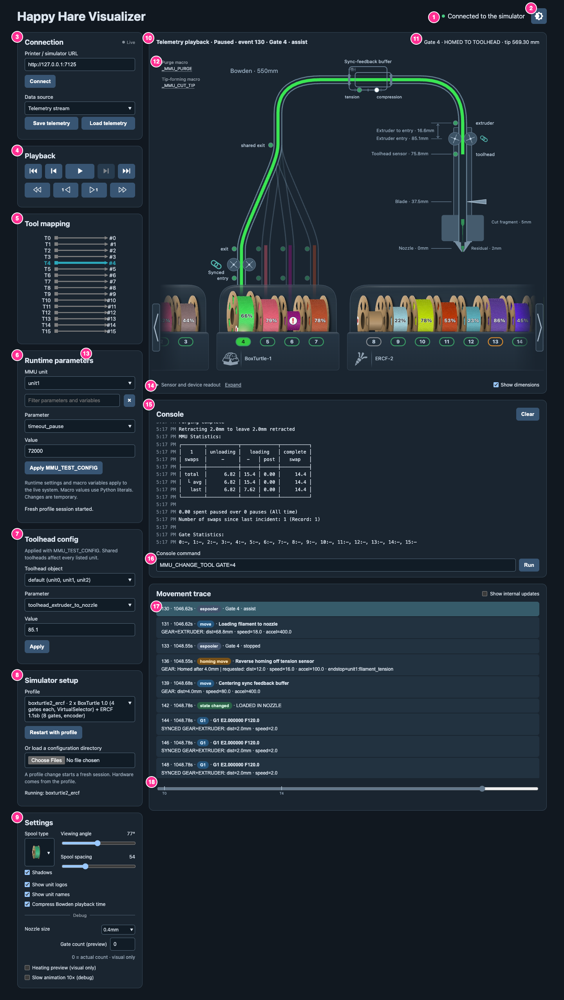
</p>

| | Panel | What it does |
|---|---|---|
| 1 | Connection status | Whether the page is connected to the printer or simulator |
| 2 | Theme | Switch between dark and light |
| 3 | [Connection](#connection-and-data-source) | Printer address, data source, save and load recordings, record to log |
| 4 | [Playback](#playback) | Step through, play and jump between toolchanges |
| 5 | [Tool mapping](#tool-mapping) | Which gate each tool is mapped to, and EndlessSpool groups |
| 6 | [Runtime parameters](#runtime-parameters) | Change a setting or macro variable live |
| 7 | [Toolhead config](#toolhead-config) | Change toolhead distances live |
| 8 | [Simulator setup](#simulator-only-controls) | Simulator only: restart on another profile |
| 9 | [Settings](#settings) | Spool appearance and playback options |
| 10 | Mode and step line | The data source in use, the playback state and the current step |
| 11 | Filament status | The gate, filament position and tip position at the current step |
| 12 | Macro names | The purge and tip-forming macros in use; click one to browse its variables |
| 13 | [Unit footer](#the-scene) | Each unit's logo, name, climate and heater |
| 14 | [Sensor and device readout](#sensors-and-devices) | Every sensor and device, with live state |
| 15 | [Console](#console) | Happy Hare's responses |
| 16 | [Command box](#console) | Send any G-code command |
| 17 | [Movement trace](#movement-trace) | Every recorded step, in order |
| 18 | [Timeline](#movement-trace) | Scrub through the recording; ticks mark toolchanges |

## Connection and data source

<p align="center">
  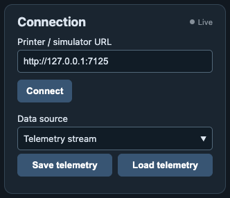
</p>

The **Printer / simulator URL** defaults to the server that served the page. Change it and press
**Connect** to point the page at another printer. The green **Live** badge shows when the page is
following the newest data.

**Data source** chooses what the scene shows:

- **Live status subscription** follows the printer's published state only (filament position, sensors,
  heaters, gate map). Motion is shown as a smooth glide to each new position: it is cosmetic, not a
  reconstruction of what the motors did. Needs nothing beyond Happy Hare itself.
- **Telemetry stream** replays the recorded events, so every move, homing outcome and cut is animated as it
  happened. Playback controls and the movement trace appear in this mode. It needs the telemetry
  component (see [Telemetry](Feature-Telemetry.md)).
- **Loaded telemetry recording** appears after you load a file. Only the file drives the scene; the
  printer cannot change it.

**Save telemetry** downloads what the page has captured (the latest 7,000 events) as a `.jsonl`
file. **Load telemetry** opens a file saved that way, or a recording from Moonraker's `logs` folder
(see [Telemetry](Feature-Telemetry.md#debug-a-problem-from-a-recording)). A loaded recording starts
paused at the beginning, and printer controls are disabled. Press **Connect** to leave the
recording and return to the printer.

**Record to log** is shown only when connected to a printer on the telemetry stream. It shows the
recording mode and changes it (`MMU_TELEMETRY`): **Off**, **On**, or **Next toolchange only**. See
[Telemetry: Commands](Feature-Telemetry.md#commands).

## Playback

<p align="center">
  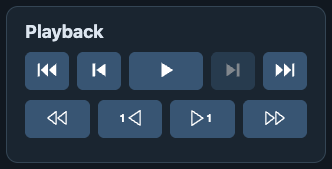
</p>

The top row moves between larger points: **Beginning**, **Previous toolchange**, **Play** (which becomes
**Pause**), **Next toolchange** and **End, go live**. The bottom row works a step at a time: **Previous step**,
**Play previous step in reverse**, **Play one step** and **Next step**.

- **Play** animates everything captured and then follows the printer live. While playing, pressing it again
  finishes the current step and pauses.
- **Previous** and **Next**, and the timeline, inspect the captured state without rewinding Happy Hare itself, and
  stop automatic playback.
- **End, go live** skips the backlog and follows the printer.
- Previous toolchange goes first to the start of the toolchange you are in, then to earlier ones.
- With the page focused and not typing in a field: **Left** and **Right** arrows go a step back or forward;
  **Shift+Left** plays the previous step in reverse and **Shift+Right** plays the next one.

Playback uses the feed speed in the recording, whatever pace the printer ran at. Acceleration is recorded but not
reproduced. Very short moves are held for at least 120 ms so they remain visible. Tick **Compress Bowden playback
time** in [Settings](#settings) to shorten long, fast transfers in proportion to how much shorter the tube is drawn.

## The scene

The main view draws your machine from its configuration: every unit side by side on a rack under the Bowden exit
(a unit with many gates wraps into rows), the gears, the sensors, the encoder, the sync-feedback buffer, the cutter,
the extruder and the nozzle. Spool colour, material fill level and gate status come from the real gate map.

<p align="center">
  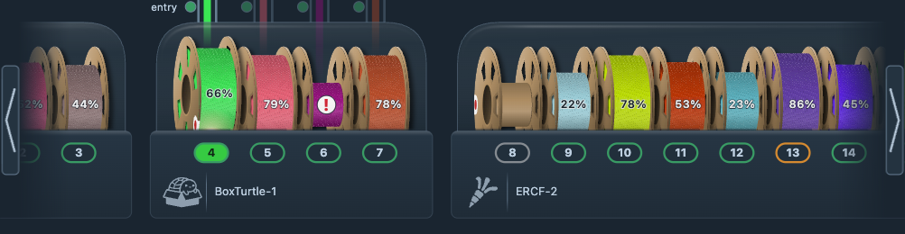
</p>

- **The rack slides** so the selected spool stays under the Bowden exit; arrows at the edge scroll it by hand
  until the next gate selection.
- **Unit footer.** Under each unit: the vendor's logo, the unit's `display_name`, humidity and temperature from its
  environment sensor, and the heater target with a heating icon (a drying icon while a gate is drying or queued).
  Where each gate has its own heater or sensor, the footer shows the selected gate's values with a tooltip listing
  every gate. The footer is read from the live printer, so a loaded recording has none.
- **Sensors** light as the filament crosses them. A sensor's last reading limits how far the drawn tip may go, so
  the picture never shows filament where a sensor says there is none. A move that contradicts a sensor
  holds at the last safe position and shows an amber **!** with the sensor details.
- A blue **i** box describes selector moves ("Positioning selector 4.2 -> 46.2 mm").
- **Show dimensions** (under the scene) toggles the measurement labels: Bowden length, extruder-to-entry,
  blade position and so on.
- Click a spool or a gate number, while connected, for the [gate menu](#the-gate-menu).

The picture is a schematic reading of commanded motion and sensor observations, not a simulation of melting
filament.

## Watching a toolchange

These clips are replays of a single toolchange each, recorded from the [simulator](Dev-Simulator.md) with
**Compress Bowden playback time** on. The simulator runs the real Happy Hare logic with a fake printer
underneath, and these show the same animation a printer produces.

### Tip forming

The tip is shaped by the [forming macro](Macro-Tip-Forming.md): the cooling moves, then the ramming and
dipping moves, appear as the extruder moves they are. The cooling tube length and position are labelled.
*Profile `boxturtle`.*

<p align="center">
  
</p>

### Cutting at the toolhead

A cutter between the extruder gears and the nozzle (the usual arrangement,
[Toolhead Cutting](Macro-Toolhead-Tip-Cutting.md)): the filament is retracted to the blade, the blade closes, the
cut fragment is pushed back to the nozzle to be purged on the next load, and the cut is verified.
*Profile `ercf_vvd`.*

<p align="center">
  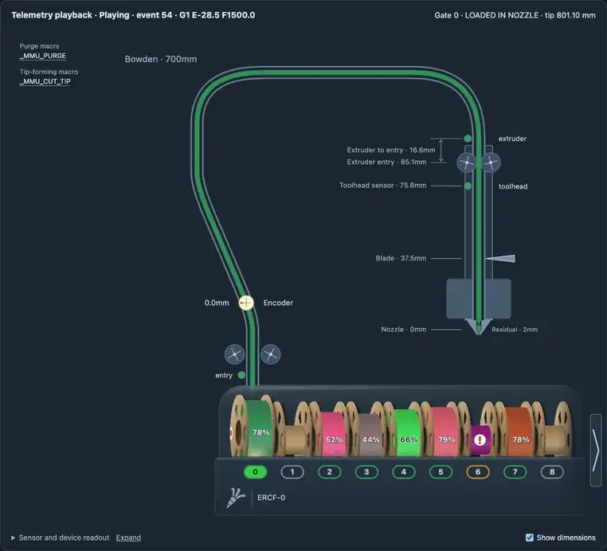
</p>

A cutter *before* the extruder gears (`variable_cutter_before_extruder: True`, see [Cutter before the extruder](Macro-Toolhead-Tip-Cutting.md#cutter-before-the-extruder)) cuts upstream of the gears instead; the blade is
drawn at the extruder entry and the fragment is pushed back through the gears. *Profile `qidi`.*

<p align="center">
  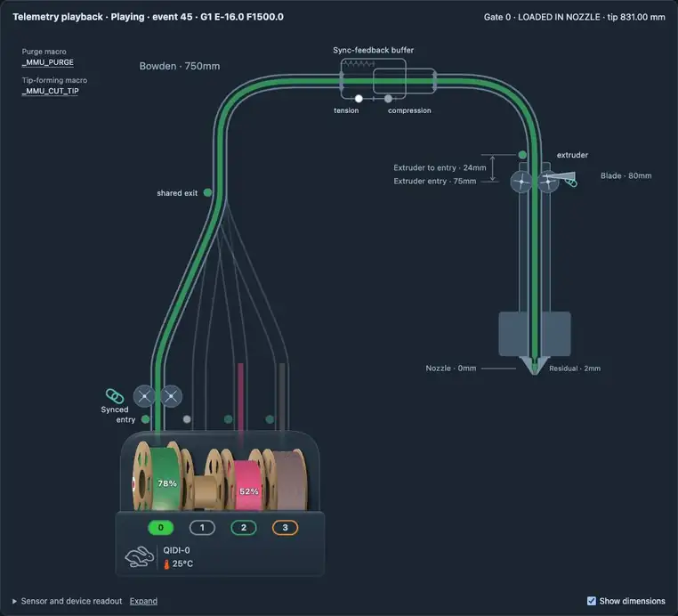
</p>

### Cutting at the MMU

A servo cutter at the MMU ([MMU Cutting](Macro-Servo-Cutter.md)) trims the filament after it has been unloaded
back to the gate. The end of the Bowden bends aside at the blade with the offcut in it; on release the offcut is
ejected. *Profile `ercf_mmu_cutter`.*

<p align="center">
  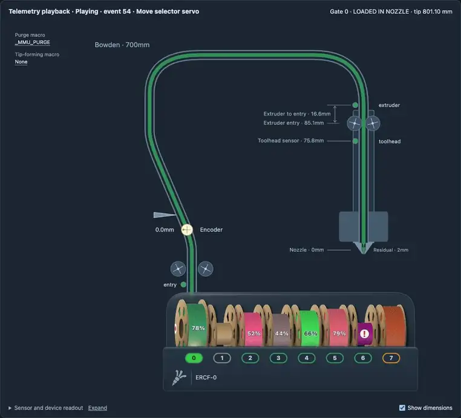
</p>

## The gate menu

<p align="center">
  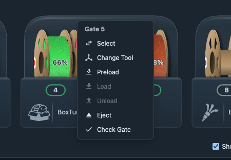
</p>

Click a spool or a gate number while connected to open a menu of commands for that gate. The clip below shows
**Select** (the rack slides to the gate), **Load** (the espooler on this BoxTurtle gate assists, the filament
travels through the Bowden and loads to the nozzle) and **Unload** (the tip is cut and the espooler rewinds),
all from the menu. *Profile `boxturtle2_ercf`.*

<p align="center">
  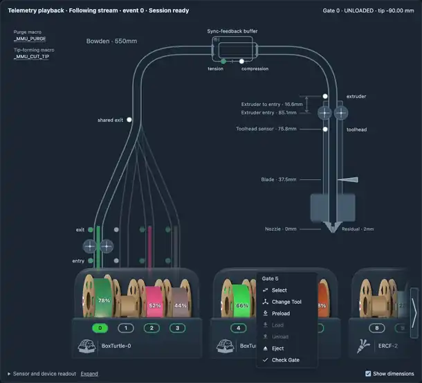
</p>

| Item | Sends | Available when |
|---|---|---|
| Select | `MMU_SELECT GATE=n` | Not the selected gate, and nothing is loaded |
| Change Tool | `MMU_CHANGE_TOOL GATE=n` | Not the selected gate |
| Preload | `MMU_PRELOAD GATE=n` | The selected gate with nothing loaded, or another gate on a unit that can crossload |
| Load | `MMU_LOAD` | The selected gate, unloaded |
| Unload | `MMU_UNLOAD` | The selected gate, loaded |
| Eject | `MMU_EJECT GATE=n` | The selected gate, or another gate on a unit that can crossload |
| Check Gate | `MMU_CHECK_GATE GATE=n` | Always |
| Scan NFC Tag | `MMU_NFC_SCAN GATE=n` | As Preload; shown only where the gate has an NFC reader |

Unavailable items are greyed. Nothing can be sent while printing, with the MMU disabled or when not connected.
The menu closes when you choose an item, press Escape, click elsewhere, move the pointer off it or after eight seconds.
The rules are the same as the MMU panel in
[Mainsail / Fluidd](Mainsail-Fluidd-Integration.md).

## Tool mapping

<p align="center">
  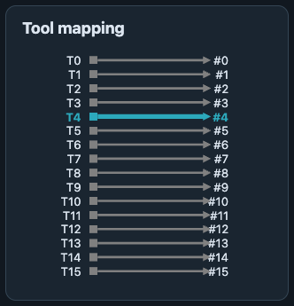
</p>

The tool-to-gate chart: tools on the left, gates on the right, a line from each tool to its gate, and a lettered bracket
for each [EndlessSpool](Feature-Endless-Spool-Runout.md) group of more than one gate. The selected tool, its gate
and that gate's group are highlighted. It is read-only and follows playback, so it also works for a recording. To
change the map see [Gate/TTG Maps](Feature-Gate-TTG-Maps.md).

## Runtime parameters

<p align="center">
  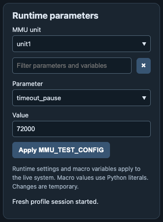
</p>

Pick a **MMU unit**, then a **Parameter** (type in the filter box to narrow the list), enter a **Value** and press
**Apply MMU_TEST_CONFIG**. The change goes through Happy Hare's own validation, so an unacceptable value is refused by
the command itself, and the change appears in the trace as a **config** step.

- Values are Python literals: `52`, `True`, `[1, 2]`. The type must stay compatible with the existing one.
- Hardware settings are not editable here.
- Changes are temporary. Put a value that works in your `.cfg` file.
- **Macro variables** appear under separate macro-name headings and are applied with `SET_GCODE_VARIABLE`. Click the
  **purge macro** or **tip-forming macro** name above the scene to jump to its variables. Output variables and
  variables assigned by macro bodies are not listed.

## Toolhead config

<p align="center">
  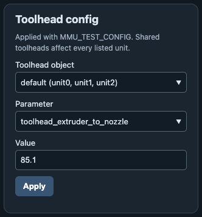
</p>

Appears when the machine has a toolhead section. Choose the toolhead, a parameter (such as
`toolhead_extruder_to_nozzle`) and a numeric value. A toolhead shared by several units is listed once with those
units, and a change affects all of them. Like the runtime parameters, edits are sent as `MMU_TEST_CONFIG`.

## Sensors and devices

<p align="center">
  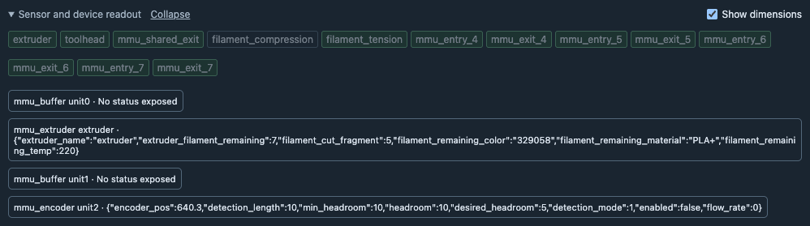
</p>

Expand **Sensor and device readout** under the scene for every sensor (lit when triggered, grey when disabled)
and the state of other devices such as heaters and fans. Click a sensor to disable or enable it
(`MMU_SENSORS`); sensors can only be toggled at the live end, so choose **End, go live** first.
Disabling one is the quickest way to see how Happy Hare behaves without it.

## Console

<p align="center">
  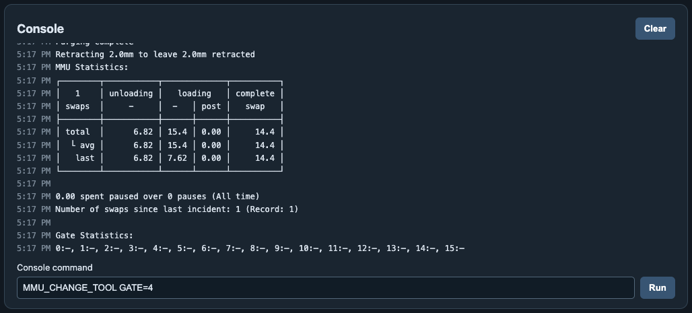
</p>

The **Console** shows Happy Hare's responses (the latest 500 lines), independently of playback. Type any command in
the box and press **Run**; commands sent from here are watched, and the page follows them. The box remembers earlier
commands. On a printer it starts empty, so a stray Enter never starts a load.

## Movement trace

<p align="center">
  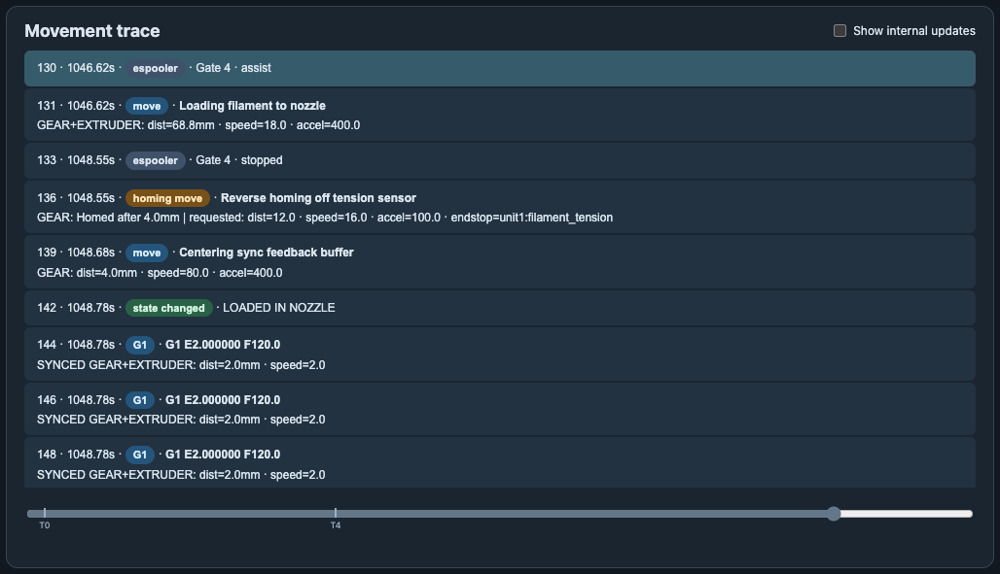
</p>

Every recorded step in order, each with its sequence number, time and type: **move**, **homing move**, **G1** (an
extruder move made by Happy Hare), **state changed**, **selector**, **gate changed**, **espooler**, **cut**,
**release** and **config**. Click a row to jump to it. The slider under the trace scrubs through the whole
recording, with a tick for each toolchange labelled with its tool. The page keeps the latest 7,000 events; a simulator
restart begins a new capture.

**Show internal updates** adds diagnostic rows and expandable raw records to the trace. Playback, the step
buttons and the timeline skip them.

## Settings

<p align="center">
  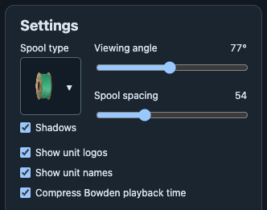
</p>

- **Spool type**, **Shadows**, **Viewing angle** and **Spool spacing** change how the spool rack is drawn.
- **Show unit logos** and **Show unit names** hide either part of the unit footer.
- **Compress Bowden playback time** shortens fast transfers, in proportion to the drawing. With it off, the
  Bowden is drawn shorter but takes the real distance / speed time.

The theme toggle in the header switches between dark and light.

## Simulator-only controls

These appear only when the page is connected to the [simulator](Dev-Simulator.md#the-happy-hare-console-in-the-simulator), and
are hidden on a printer:

- **Simulator setup**: restart on another built-in profile, or upload a configuration directory.
- The **Buffer** and **Encoder** panels, which set object values directly.

## Troubleshooting

**The page loads but shows "Connecting".** The page cannot reach Moonraker. Check the address in
**Printer / simulator URL**, and that Moonraker is running.

**403 after `./install.sh -w`.** Run `chmod o+x ~`.

**Telemetry stream shows no steps.** The telemetry component is not loaded - see
[Telemetry: Troubleshooting](Feature-Telemetry.md#troubleshooting).

**The gate menu does nothing.** It is disabled while printing, when the MMU is disabled or when not connected.

## See also

- [Telemetry](Feature-Telemetry.md)
- [The Simulator](Dev-Simulator.md)
- [Mainsail / Fluidd](Mainsail-Fluidd-Integration.md) and [KlipperScreen](KlipperScreen.md)
- [Understanding MMU State](Understanding-Operation.md)

---
