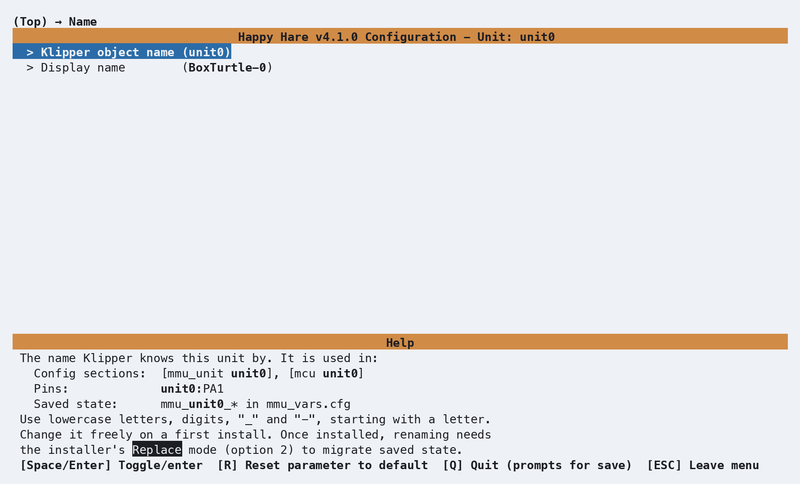

# Installation

Happy Hare is a set of Klipper "extra" modules, a Moonraker component, and a
set of macros and config templates. Installing it is the same shape as
installing Klipper itself: clone the repository, then run its install script.
This page covers the parts that are the same regardless of which MMU you're
setting up — cloning, the installer's command-line flags, the optional client
macros, and upgrading later. The actual first-run walkthrough (the
`menuconfig` screens you'll see and the choices worth pausing on) is one page
per MMU type - see the getting started guides for popular machines as examples.

## Cloning Happy Hare

Log into the machine running Klipper (most commonly a Raspberry Pi) as the user you
used to install klipper over SSH using PuTTY, KiTTY, MobaXterm, ssh or similar utility
(e.g. `ssh pi@myprinter.local`), then clone the repository:

```bash
cd ~
git clone https://github.com/moggieuk/Happy-Hare.git
cd Happy-Hare
```

## Running the Installer

Consult the Getting Started guide for your particular MMU type (or pick a design
similar to yours because there is often a lot of overlap) for a walk-through of
essential `menuconfig` screens and hardware verification. In the unusual case
you need special install options keep reading.

```bash
./install.sh
```

The very first time this runs, there's no config yet, so it drops straight
into `menuconfig` automatically - no flag needed for that first pass. On every
later run, `./install.sh` with no flags just re-applies your existing choices
(a safe re-install/upgrade); to go back into `menuconfig` and change
something, add `-i`:

```bash
./install.sh -i
```
The installer looks for Klipper and Moonraker in their standard locations.
If you've customized where they live, or have more than one Klipper instance
on the same machine, override the paths directly:

```text
./install.sh -k <klipper_home_dir> -c <klipper_config_dir> -m <moonraker_home_dir>
```

!!! note
    An existing install is never overwritten outright - it's moved to a
    timestamped backup directory (e.g. `mmu.old-20260807-102329`) and the new one is
    rebuilt from your previous choices plus whatever you change this run.


## Naming an MMU unit

On a first installation, open **Name → Klipper object name** in `menuconfig` to
choose the first unit's name. It defaults to `unit0`, but is not fixed. Use a
lowercase letter first, followed by lowercase letters, digits, `_` or `-`.

For example, choosing `box` produces sections such as `[mcu box]` and
`[mmu_unit box]`, pin prefixes such as `box:PA1`, and per-unit files such as
`mmu_hardware_box.cfg` and `mmu_parameters_box.cfg`. Configuration examples in
these guides commonly use `unit0`; substitute your configured name when copying
unit-specific sections, pins or commands.

**Name → Display name** is a separate label for Mainsail, Fluidd and KlipperScreen
and may contain spaces. Changing this label leaves the Klipper object name intact.

<p align="center">
  
</p>

To rename an already installed unit, run `./install.sh -i` and choose
**Replace (option 2)** so the installer can migrate its files and saved state.
In multi-unit mode, names are edited in the shared **MMU units** list; each unit's
**Name** menu displays its object name but does not edit it. See
[Unit renaming](GettingStarted-Multi-Unit.md#unit-renaming) for the complete
procedure and the effect of Replace mode on manual configuration edits.

## Arguments & other common install options

=== "Full install.sh flag reference"
    <br>
    ```{.text .console-command}
    ./install.sh --help
    ```
    ```{.text .console-output}
    Usage: ./install.sh [-i] [-u] [-d] [-y] [-l] [-p] [-z] [-s] [-t] [-r]
                        [-b <branch>] [-g <gates>]
                        [-k <klipper_home_dir>] [-c <klipper_config_dir>] [-m <moonraker_home_dir>]
                        [-a <kiauh_alternate_klipper>] [config_file]

    (no flags for safe re-install / upgrade)
    [config_file] is optional, if not specified the default config filename (.mmu_config) will be used.
      -i for interactive install (open menuconfig)
      -u, -d for uninstall
      -b <branch> to switch to specified feature branch (sticky)
      -n to specify a multiple MMU unit setup
      -k <dir> non-default klipper home directory
      -c <dir> non-default klipper config directory
      -m <dir> non-default moonraker home directory
      -p, --prev choose a MMU backup and recover its configuration

      Advanced:
      -y, --yes automatically answer yes to all y/n prompts
      -l, --last recover .mmu_config files from the last config backup
      -f to just restore klipper/moonraker symlinks (recover after hard klipper update)
      -z skip github update check (nullifies -b <branch>)
      -s to skip restart of services
      -a <name> to specify alternative klipper-service-name when installed with Kiauh
      -r allow running install.sh from a root login (not through sudo)
      -e, --emu Enables multi MCU support (e.g. for EMU design)
      -g <gates> most gates one MMU unit can configure (default 12, sticky; more is slower)
      -o override compatibility checks (e.g. unknown MIPS layout)
      -t  activate test mode - write config to /tmp/mmu_test instead of your real install
      (-q verbose make for debugging)
      (-v verbose builder for debugging)
    ```

=== "Test Mode"

    !!! tip
        Nervous about running the installer against a live config? `-t` builds
        and generates configuration in an isolated `/tmp` directory instead of touching your real
        printer config, so you can review results before committing to it.

    This is enabled by specifying `-t` e.g.

    ```bash
    ./install.sh -i -t
    ```
    ```json
    Running in test mode to simulate without changing real configuration
    Forcing flags '-s -c /tmp/mmu_test/printer_data/config -k /tmp/mmu_test/klipper -m /tmp/mmu_test/moonraker /tmp/mmu_test/.mmu_config'
    ```

=== "Multiple MMU's"

    Happy Hare can manage multiple MMUs connected to the same printer. Each unit
    has its own Klipper object name and display name.

    This is enabled by specifying `-n` e.g.

    ```bash
    ./install.sh -i -n
    ```

    The existing unit keeps its chosen name when converting to multi-unit mode.
    Later runs detect multi-unit mode automatically with `./install.sh -i`.
    See [Multiple MMU Units](GettingStarted-Multi-Unit.md) for adding, renaming,
    reordering and removing units.

=== "Per Lane Controllers"

    For MMU's like EMU that use dedicated controllers/MCU's per lane, support needs
    to be enabled by specifying `-e` or `--emu` e.g. 

    ```bash 
    ./install.sh -i -e
    ```

    Once your configuration has per-gate MCU support enabled, later runs turn it
    on automatically, so `-e` isn't needed again.

=== "More than 12 gates"

    Menuconfig offers per-gate options (sensor pins, gear steppers, LEDs, ...)
    for up to 12 gates per MMU unit. For a unit with more lanes, such as a large
    Tradrack or ERCF, raise the limit with `-g <gates>` e.g.

    ```bash
    ./install.sh -i -g 16
    ```

    The limit is saved in your configuration, so later runs keep it and `-g`
    isn't needed again. Run with a different `-g` to change it. Lowering it
    drops the per-gate settings above the new limit. A higher limit makes
    menuconfig a little slower to start, so only raise it as far as you need.

    If a unit has more gates than the limit, menuconfig warns:
    `More gates than the 12 menuconfig can configure: ./install.sh -g <gates>`

## Client Macros

`menuconfig`'s final section asks:

> Install default client macros supplied with Happy Hare? (STRONGLY recommended)

Saying yes (the default) includes `client_macros.cfg` - ready-made
`PAUSE`/`RESUME`/`CANCEL_PRINT` macros that already know how to work with
Happy Hare's own toolhead-parking logic on an MMU error, rather than just the
plain Klipper versions. If you already have your own `PAUSE`/`RESUME` macros and
want to keep them, say no here - see
[Operation](Operation.md#what-happens-when-the-mmu-pauses) for what your own
macros need to account for.

!!! info
    The installer will insert `[include mmu/optional/client_macros.cfg]` into
    `printer.cfg` after the last `[include ... ]` block, or at the end of
    `printer.cfg` to ensure these macros are used in preference to
    any other `PAUSE`/`RESUME`/`CANCEL_PRINT` macros.

## Upgrading

Happy Hare registers itself with Moonraker's update manager, so routine
updates show up the same way any other Klipper plugin's do - Mainsail/Fluidd
will offer an update when one's available (allow up to 24 hours, or click the
refresh arrow to check immediately).

Occasionally an update needs more than a code pull - a config or menuconfig
change that update manager alone can't apply. When that happens, re-run the
installer with no flags from your Happy-Hare checkout:

```bash
cd ~/Happy-Hare
./install.sh
```

This is always safe to run speculatively - if there's nothing to do it does
nothing, and every run backs up your existing config to a fresh timestamped
directory first regardless. Custom paths given with `-k`, `-c` or `-m` are
saved in `.mmu_config`, so later runs use them without the flags. To change
them, use the **Paths & Services** menu in `menuconfig`.

If an upgrade goes wrong, see
[Recovering Configuration from a Backup](GettingStarted-Installer-Configurator.md#recovering-configuration-from-a-backup)
to restore one of those backups.

## Choosing an upgrade mode

When you run `./install.sh -i` over an existing configuration, the installer asks
how to reconcile your `menuconfig` choices with edits made directly to your Happy
Hare `.cfg` files. [Managing Configuration Changes](GettingStarted-Installer-Configurator.md#managing-configuration-changes)
shows the prompt; this section compares the two modes in detail.

Both modes start the same way: the configuration is regenerated from your
`menuconfig` choices, which are stored in `.mmu_config`. The modes differ in how
much of your existing `.cfg` files is then copied back on top.

!!! note
    `./install.sh` without `-i` doesn't ask and doesn't open `menuconfig`. It keeps
    every value in your `.cfg` files, apart from the few structural options
    `menuconfig` always sets (see the comparison below), and adds any new options,
    with no import step.

### Comparison

| | **1) Merge/Refresh** (default) | **2) Replace** (recommended) |
| --- | --- | --- |
| **Which wins** | Your `.cfg` files, except for settings you change in `menuconfig` this run | `menuconfig` |
| Values edited in a `.cfg` file, such as currents, speeds, distances, pins and macro variables (`_MMU_*_VARS`, `_BLOBIFIER_VARS`) | Kept. Values `menuconfig` can show are offered for import before it opens | Overwritten |
| Settings changed in `menuconfig` this run | Applied. A hand edit they replace is reported as a warning | Applied |
| Settings not changed in `menuconfig` this run | Keep their `.cfg` values | Rebuilt from `menuconfig` |
| New options and sections from a newer release | Added | Added |
| Options and sections you added yourself | Dropped, and listed in the install output | Dropped |
| Configuration below the `# EXCLUDE FROM CONFIG BUILDER` line in `mmu.cfg` and `mmu_hardware.cfg` | Kept unchanged | Regenerated, so your additions are kept only in the backup |
| Optional `mmu_parameters` settings that the template doesn't list, such as `default_gate_material` or `error_macro` | Kept | Kept |
| Edited `gcode:` bodies of Happy Hare macros | Lost | Lost |
| The unit list and encoder/buffer references (`[mmu_machine] units`, `[mmu_unit] encoder` and `buffer`) | Always set by `menuconfig`. A hand edit is listed before `menuconfig` opens | Always set by `menuconfig` |
| Renaming, removing or reordering units | Not allowed | Possible |
| [Backup](GettingStarted-Installer-Configurator.md#recovering-configuration-from-a-backup) of the existing configuration | Yes | Yes |
| [Summary of changes](#summary-of-changes) at the end of the install | Yes | Yes |

### When to use each mode

**1) Merge/Refresh: you edit `.cfg` files directly, or want to bring `menuconfig` up to date with them**

- Use it to upgrade Happy Hare and pick up new options without losing any value
  you have tuned in a `.cfg` file.
- Use it to change a few settings in `menuconfig` while keeping your hand edits.
  Only the settings you change in `menuconfig` are applied; every other option
  keeps its `.cfg` value, apart from the exceptions in the
  [comparison](#comparison).
- Not every edit can be imported back into `menuconfig`: for example, a value
  `menuconfig` builds from several settings, or one that would also change
  another option. Those values stay in your `.cfg` file and keep working, but
  `menuconfig` goes on showing its own value. Run `./install.sh -i -v` to list
  them, with the reason each can't be imported, then set them in `menuconfig`
  yourself if you want it to match. See
  [Importing `.cfg` values into menuconfig](#importing-cfg-values-into-menuconfig).
- If you are unsure, choose Merge/Refresh. It doesn't change any value you
  haven't changed in `menuconfig` during the run.

**2) Replace: `menuconfig` is your single source of truth**

- Use it when you make all configuration changes through `menuconfig`.
- Use it when changing hardware, such as a new MMU type, controller board or
  selector.
- Use it to return to a known-good starting point after the configuration has
  drifted.
- It is required to rename, remove or reorder units. See
  [Multiple MMU Units](GettingStarted-Multi-Unit.md#unit-renaming).
- Everything edited by hand is replaced. Run Merge/Refresh first and accept the
  import, so that `menuconfig` holds your tuned values, then copy any value it
  couldn't import into `menuconfig` by hand. The previous files remain in the
  backup directory.
- This includes the configuration below the `# EXCLUDE FROM CONFIG BUILDER`
  line. Replace regenerates it, because some MMU types put hardware that
  `menuconfig` manages there, and it must follow unit renames and hardware
  changes. Copy anything you added there back from the backup afterwards, or
  keep it in a file of your own (see [Recommendations](#recommendations)).

### Importing `.cfg` values into menuconfig

When you choose Merge/Refresh, the installer compares your installed `.cfg` files
with what `menuconfig` would generate before `menuconfig` opens. If the files hold
values that `menuconfig` can show, it lists them by file and section, then asks
once whether to import them:

```{.text .console-output}
These .cfg values will be imported into menuconfig:

> mmu_macro_vars.cfg:
[gcode_macro _MMU_SOFTWARE_VARS]
variable_home_mmu: True

> mmu_parameters_unit0.cfg:
[mmu_unit_parameters unit0]
gear_load_speed: 123
gear_unload_speed: 88

Import these .cfg values into menuconfig (y/n)?
```

The list includes your hand edits, and also old default values that your `.cfg`
files still hold after a release changed the default. If nothing needs
importing, the installer doesn't ask. `-y` answers yes.

- **Yes**: `menuconfig` opens showing the values you are actually running.
- **No**: `menuconfig` opens showing its previous values, and your `.cfg` files
  keep theirs. A setting you then change in `menuconfig` is still applied,
  replacing the value in your `.cfg` file.

A few structural options always come from `menuconfig` in every mode, because
they name sections `menuconfig` generates: `units` in `[mmu_machine]`, and
`encoder` and `buffer` in `[mmu_unit]`. If you edited one by hand, it is listed
before `menuconfig` opens, under "These .cfg values are always set by menuconfig,
so your edits will be replaced", and `menuconfig`'s value is installed.

A value can be imported when its option takes its whole value from a single
`menuconfig` setting, including pins and per-gate values, and when that setting
appears in `menuconfig` or follows one toggle or list that does. The value must
be one `menuconfig` accepts, within its range, and importing it must change no
other option. A value that already matches `menuconfig`'s default isn't imported,
so `.mmu_config` keeps treating it as a default rather than a value you set.

To take a release's new default instead of the old value your `.cfg` file
holds, accept the import, then press **R** on that setting in `menuconfig` to
reset it. The reset counts as a change and is applied. Declining the import
keeps the old value.

Anything else stays in your `.cfg` file. Run `./install.sh -i -v` to also list
those values with the reason each can't be imported, and to see the
`menuconfig` value each import replaces. `-v` is a developer option that also
makes the rest of the install output much longer.

!!! warning "Important"
    The import doesn't run when converting to multi-unit mode with `-n`. In that
    run, Merge/Refresh keeps every value already in your `.cfg` files, even for
    settings you change in `menuconfig`. Run `./install.sh -i` again afterwards
    to import your values and make further changes.

### Summary of changes

Every install over an existing configuration ends by summarizing what it changed
in your Happy Hare `.cfg` files. That includes `./install.sh -i` in either mode
and a plain `./install.sh`. A first install has nothing to compare with, so it
prints no summary. The summary appears once the new files are installed, before
Klipper and Moonraker restart and the "Happy Hare is ready" banner. For example,
after changing one setting in `menuconfig`:

```{.text .console-output}
----------------------------------------------------------------------------------------------------------

Summary of changes to your Happy Hare .cfg files (previous files are in 'mmu.old-20261016-145447'):

> mmu_parameters_unit0.cfg:
Changed:
[mmu_unit_parameters unit0]
gear_unload_accel: 100 -> 101

----------------------------------------------------------------------------------------------------------
```

The installer compares each file in `mmu/base/` with the same file in the backup
directory named in the heading, which holds your previous files. It lists only
the files that changed. Under each file name, it shows up to three groups,
each listed by section:

- **`Changed:`** options whose value is different, as `old -> new`. A line ending
  `(your .cfg edit, replaced by a menuconfig change)` was a value you had edited
  by hand, and a setting you changed in `menuconfig` replaced it. Replace doesn't
  mark lines this way, but every hand edit it overwrote appears here.
- **`Removed:`** options that are no longer in the file, with the value they had.
  A removed section appears as its `[section]` line alone. Options and sections
  you added yourself, which the templates don't render, appear here.
- **`Added:`** a count of new options and sections, such as
  `Added: 3 new option(s) and 1 new section(s)`. These come from a newer release
  or a feature you enabled.

Only values are compared, so changes to comments, layout or template wording
don't appear. Neither do `gcode:` bodies or anything below the
`# EXCLUDE FROM CONFIG BUILDER` line. If no value changed, the block shows
"No changes to the values in your Happy Hare .cfg files" instead.

With `-v`, `Added:` lists every new option with its value, and a word diff of
each file against the backup follows the block.

### Recommendations

- If you are unsure, choose **Merge/Refresh** and accept the import.
- To move from hand-editing to `menuconfig`, run Merge/Refresh with `-v` and
  accept the import. Copy any value listed as not importable into `menuconfig`,
  then run **Replace** once. Use either mode from then on.
- Keep your own macros and extra sections in a separate file included from
  `printer.cfg`. No upgrade mode changes it. Configuration below the
  `# EXCLUDE FROM CONFIG BUILDER` line survives Merge/Refresh, but not Replace.
- After an upgrade, read the summary of changes and any "have been dropped"
  warnings in the install output, and compare the new files with the
  timestamped backup if anything looks wrong. To restore a backup, see
  [Recovering Configuration from a Backup](GettingStarted-Installer-Configurator.md#recovering-configuration-from-a-backup).

## Troubleshooting

- **"`step pin not defined for...`" at Klipper startup** - usually means a
  Klipper update wiped the symlinks Happy Hare needs. Run `./install.sh -f`
  to restore just the symlinks without going through the rest of the
  installer.
- **Multiple Klipper instances on one machine** (e.g. via Kiauh) - use `-a
  <service_name>` together with `-k`/`-c` pointed at that instance's
  directories.
- **"`Unknown MIPS layout`" on an embedded printer** - the installer knows the
  directory layout of Creality K1, Guppy K1 and FlyOS-Fast systems. On any
  other MIPS system, pass `-k`, `-c` and `-m` with your actual directories, or
  add `-o` to continue without platform-specific path defaults.

## See also

- [Getting Started with Box Turtle](GettingStarted-BoxTurtle.md)
- [Getting Started with BTT ViViD](GettingStarted-ViViD.md)
- [Getting Started with EMU](GettingStarted-EMU.md)
- [Getting Started with ERCF](GettingStarted-ERCF.md)
- [Getting Started with Tradrack](GettingStarted-Tradrack.md)
- [Getting Started with MMX](GettingStarted-MMX.md)
- [Operation](Operation.md) - what happens when the MMU pauses, and how to
  resume/recover

---
