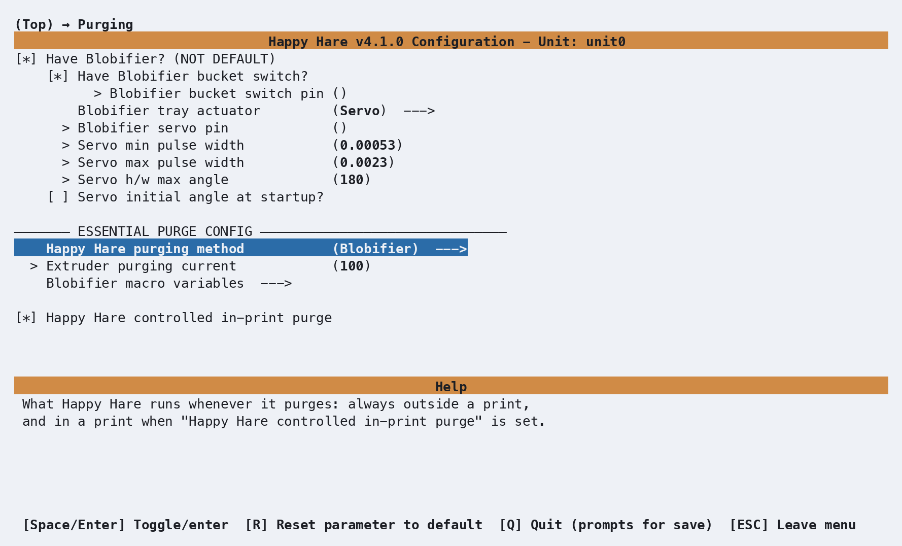
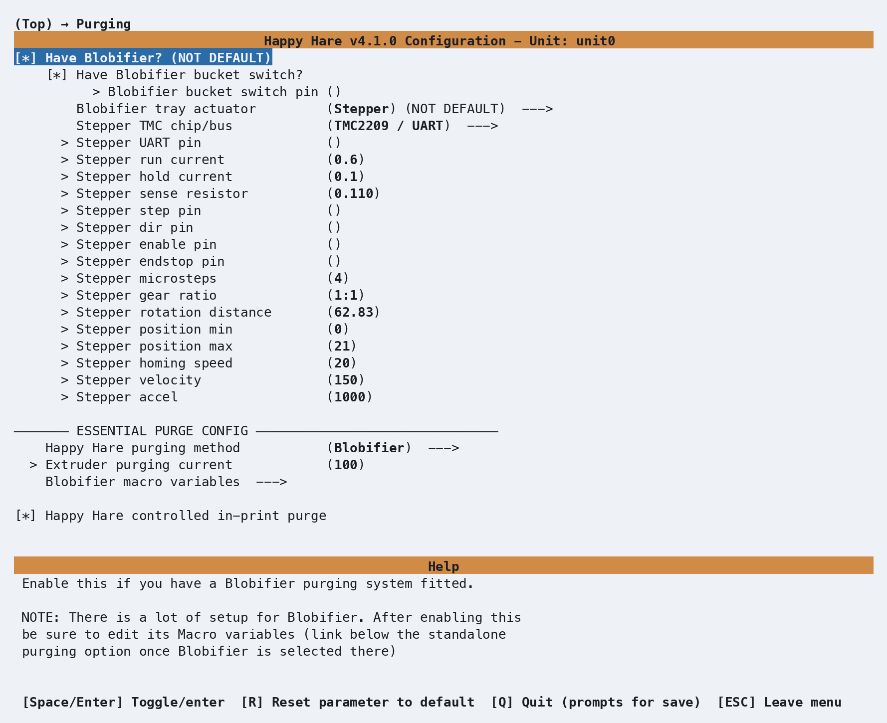
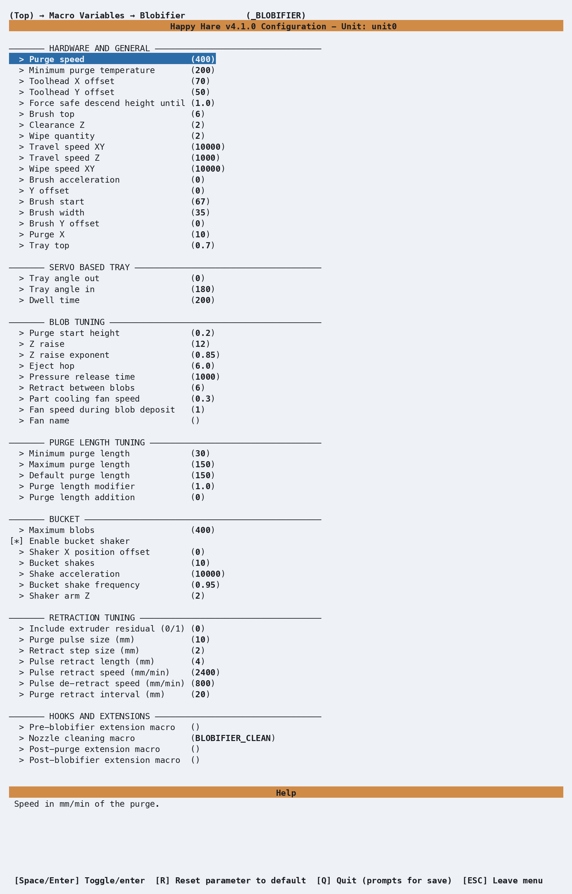

# Purge: Blobifier

## What it does

  

Tunes Blobifier, a standalone purge system that replaces the slicer's wipe
tower with a purge tray and collection bucket. It is configured through
menuconfig's **Purging** screen (**Have Blobifier?**). Genuinely the largest
single tuning surface on this site, third-party-maintained and reproduced
here in full rather than left to its upstream README alone. Physical build
instructions are at [Blobifier's own project
page](https://github.com/Dendrowen/Blobifier).

## Where it's applied

Defined in `blobifier.cfg`, active once `purge_macro: BLOBIFIER` in
`mmu.cfg` (select **Blobifier** as the standalone purging option under
menuconfig's **Purging** screen - the tray actuator type, servo or stepper,
is also chosen there, not on the Macro Variables screen below). Three
extension points fire around the purge itself, distinct from - and not
listed on - [Macro Customization](Macro-Customization.md)'s general table,
since they're scoped to Blobifier's own sequence rather than Happy Hare's
load/unload cycle: `user_pre_blobifier_extension` (at the very start, after
state is saved), `user_post_purge_extension` (after purging and cleaning,
before Z is restored), and `user_post_blobifier_extension` (after Z is
restored). All three exist specifically for a gantry-mounted brush/nozzle
leak-stop setup that needs its own parking logic around the sequence; leave
them blank for the default bed-mounted brush.

!!! tip
    Parking the nozzle over the tray during a swap is better handled
    through the standard parking configuration in [Macro:
    Sequence](Macro-Sequence.md) than the older
    `variable_user_post_form_tip_extension: 'BLOBIFIER_PARK'` approach -
    the newer mechanism accounts for toolhead movement more generally
    rather than being specific to this one add-on.

Set these three hooks and `clean_macro` under **Macro Variables → Blobifier →
Hooks and Extensions**. Enter macro names or G-code without surrounding quotes.
The default cleaning macro is `BLOBIFIER_CLEAN`; leave it blank to skip cleaning.

## Enabling Blobifier

Open menuconfig's **Purging --->** screen and enable **Have Blobifier?**.
This expands the screen with the bucket-presence input and the tray actuator
settings. Then open **Happy Hare purging method** and choose
**Blobifier**. Check this choice explicitly when adding Blobifier to an
existing configuration: menuconfig can retain the previous **Simple purge
into bucket** selection.

  

The fields in this screen configure the hardware generated in `mmu.cfg`:

| Setting | Purpose |
|---|---|
| **Blobifier bucket switch pin** | Input for the bucket-presence switch. Enter the fully qualified MCU pin and retain the `^` pull-up prefix. Removing the bucket clears Blobifier's stored blob count. |
| **Blobifier tray actuator** | Select **Servo** for the servo-driven tray or **Stepper (manual_stepper)** for the stepper-driven tray. This also sets the actuator type used by the Blobifier macros. |
| **Blobifier servo pin** and pulse widths | Generated as `[mmu_servo blobifier]`. The default pulse widths are starting points; tune the minimum for fully out and the maximum for fully in without servo buzz. |
| **Servo h/w max angle** and startup angle | Match the servo's angular range to its pulse widths. Optionally set a position to apply at Klipper startup. |
| **Happy Hare purging method** | Choose **Blobifier**. **Simple purge into bucket** runs the much simpler `_MMU_PURGE` macro and does not activate Blobifier. |
| **Happy Hare controlled in-print purge** | Leave enabled to use Blobifier during prints, and turn off the slicer's wipe tower. |

Selecting **Stepper (manual_stepper)** replaces the servo fields with the
step, direction, enable and endstop pins, TMC driver selection and connection
settings, motor current, rotation distance, microsteps, gear ratio and motion limits:

  

**Stepper TMC chip/bus** defaults to **TMC2209 / UART**. Select the fitted
driver here; menuconfig exposes the corresponding UART or SPI connection
settings and generates its driver section. The stepper endstop commonly needs
the `^!` pull-up and inversion modifiers shown in the prompt's help.

The bucket switch above detects whether the collection bucket is fitted. It
is separate from the bucket-capacity and shaker settings on the Macro
Variables screen below: `max_blobs`, `enable_shaker`, `shaker_pos_x`,
`bucket_shakes`, `shake_accel`, `bucket_shake_frequency` and
`shaker_arm_z`.

## Configuration

  

`_BLOBIFIER_VARS` in `mmu_macro_vars.cfg`, reachable from menuconfig's
**Macro Variables → Blobifier (\_BLOBIFIER)** screen shown above, once
Blobifier is enabled. The full variable table, organized the same way
as the shipped file's own sections, is on [Macro Variables:
Blobifier](Reference-Macro-Vars.md#blobifier-_blobifier_vars) - not repeated here.
Three settings are explicitly flagged **must calibrate** rather than
tune-to-taste: `toolhead_x`/`toolhead_y` (nozzle-to-toolhead-edge offsets)
and `tray_top` (the tray's real Z height) - the shipped defaults are a
specific build's measurements, not a sensible starting point for yours.

!!! warning "Skew correction"
    Blobifier's purge row and brush sit at the back edge of the machine
    (Y max less `y_offset` / `brush_y_offset`), and the shaker at the X
    minimum side (`shaker_pos_x`). With Klipper `[skew_correction]` loaded,
    these positions can end up beyond the axis limits as Z increases. Happy
    Hare pulls those moves just inside the limit automatically and warns once
    per print, but the nozzle then isn't exactly where you calibrated it. Use
    `MMU_CHECK_POSITION` with your skew profile to see how far inside the edge
    the positions need to be, and adjust `y_offset`, `brush_y_offset` or
    `shaker_pos_x` to match. The former `skew_correction` variable has been
    removed. If you used it for extra clearance, add that amount to these
    offsets instead. See [Skew & Build Envelope](Skew-Build-Envelope.md).

### Parking, temperature and synchronization

`BLOBIFIER_PARK` requires XYZ homing. It requires completed quad gantry leveling
only when `[quad_gantry_level]` is configured. When the tray is marked unsafe,
`force_safe_descend_height_until` still permits descent to `tray_top` while the
recorded print height is below that threshold. At or above it, the unsafe-tray
guard prevents descent; `0` disables this override for nonnegative print heights.
Check physical clearance before relying on the low-height override.

If Blobifier raises the nozzle temperature for a purge, it restores the previous
target afterward unless another macro changed that target during purging. This
restoration does not itself wait for cooldown. Blobifier does not adjust buffer
tension between blobs; with a sync-feedback buffer, Happy Hare adjusts tension
after loading (`toolhead_post_load_tension_adjust`).

When approaching the brush, after wiping and after the tray retracts, the
nozzle moves to `brush_clearance_x` mm left of `brush_start` (never below
X=30) to stay clear of the tray and any Filametrix cutter pin. The default of
20 mm suits the standard build; change it if your brush, tray or cutter needs
a different gap.

## See also

- [Feature: Tip Forming and Purging](Feature-Tip-Forming-Purging.md) - the
  `purge_macro` setting that activates Blobifier as an alternative to
  `_MMU_PURGE`
- [Macro Variables: Blobifier](Reference-Macro-Vars.md#blobifier-_blobifier_vars) -
  every `_BLOBIFIER_VARS` setting in full
- [Toolchange Movement](Toolchange-Movement.md#tip-cutting-options) - a
  worked example combining Blobifier with a fully custom park/purge, no
  wipe tower
- [Purge: Simple](Macro-Purge.md) - the simpler built-in alternative
- [Skew & Build Envelope](Skew-Build-Envelope.md) - keeping edge positions in
  range with skew correction, and checking them with `MMU_CHECK_POSITION`

---
