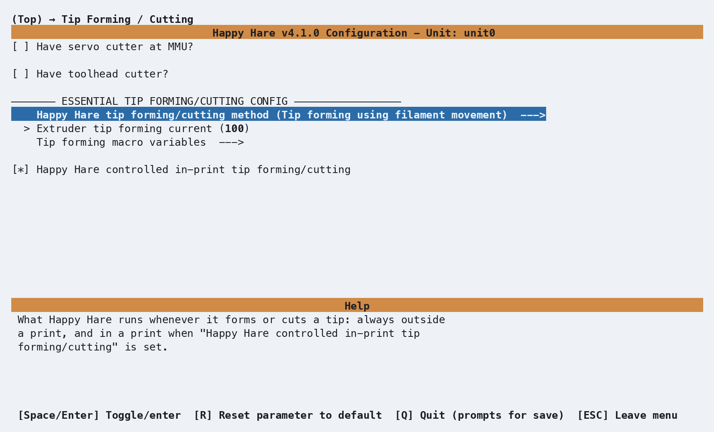
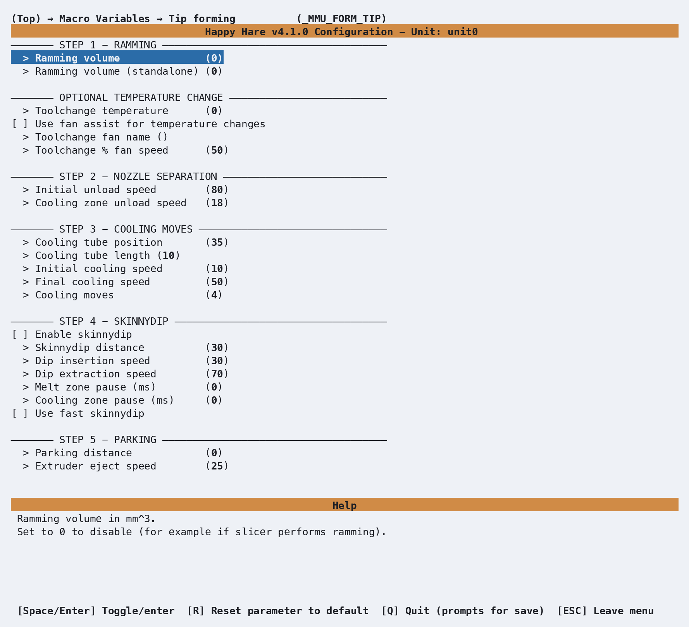

# Tip Shaping: Forming

## What it does

Happy Hare's standalone filament-tip-forming macro - the default way to get
a clean, hair-free tip before an unload, working similarly to
PrusaSlicer/SuperSlicer's own tip forming. See [Feature: Tip Forming and
Purging](Feature-Tip-Forming-Purging.md) for the concept, the alternative
methods (toolhead cutting, slicer-controlled), and the full step-by-step
[tuning workflow](Feature-Tip-Forming-Purging.md#tuning-tip-forming) using
`MMU_TEST_FORM_TIP` - this page doesn't repeat that, just the menuconfig
view of the variables it tunes.

## Where it's applied

`_MMU_FORM_TIP`, defined in `mmu_form_tip.cfg`. Active whenever
`form_tip_macro: _MMU_FORM_TIP` in `mmu.cfg` (the default) - runs through
five steps in order: ramming, nozzle separation, cooling moves, an optional
skinnydip pass, then parking the result for eject/inspection or the next
unload step.

The Macro Variables screen is always visible regardless of whether tip
forming or toolhead cutting is selected. [Tip Shaping: Toolhead
Cutting](Macro-Toolhead-Tip-Cutting.md)'s screen only appears once a
toolhead cutter is enabled.

Happy Hare zeroes pressure advance for the duration of the macro call, so
the ramming/cooling moves aren't distorted by it, then automatically
restores whatever value was active beforehand once tip forming completes -
nothing to configure or restore by hand.

## Selecting filament-movement forming

Open menuconfig's **Tip Forming / Cutting --->** screen, then open **Happy Hare
tip forming/cutting method** and choose **Tip forming using filament
movement**. This writes `form_tip_macro: _MMU_FORM_TIP` to `mmu.cfg`.

  

The other settings on this screen control when and how forming runs:

| Setting | Purpose |
|---|---|
| **Have servo cutter at MMU?** | Enables the separate [MMU-mounted cutter](Macro-Servo-Cutter.md). That cutter is additive and does not replace this tip-shaping selection. |
| **Happy Hare controlled in-print tip forming/cutting** | Leave enabled to run `_MMU_FORM_TIP` during prints and disable the slicer's own tip forming. Disable it when the slicer will form the tip; menuconfig then exposes **Slicer tip park pos**. |
| **Extruder tip forming current** | Percentage of normal extruder current to use while forming. `100` disables the boost; increase it only as needed, up to `150`. |

## Tip-forming animation

Follow the macro through ramming, the three-part separation pull, four cooling
cycles, optional skinnydip and parking. The animation uses the shared toolhead
and MMU view without a cutter; the formed filament tip is schematic.

This illustrative example enables 23mm³ ramming, a 35mm cooling-tube position and 10mm cooling stroke,
skinnydip and 500ms dwell times. These are demonstration settings, not a tuning
recommendation: ramming, temperature changes and skinnydip are disabled by
default. The MMU is shown synced to the extruder, with a 2mm initial toolchange retract
and 3mm residual-filament allowance. Ramming first recovers the initial retract;
residual melt stays behind when the tip separates. These allowances reduce the
separation pull to 40mm before the cooling strokes.
Movement and temperature waits are slowed for readability. After the macro
finishes, the animation continues through the surrounding unload, load and purge
sequence using the same toolhead and MMU movements as
the cutting examples, with no cut fragment.

  
Tip forming first rams filament, retracts it from the nozzle into a cooling
  zone, moves it back and forth to cool, optionally dips it into the melt zone,
  then parks the shaped tip for unloading. The MMU unloads it, loads the next
  filament and purges the residual melt before the color transition.

## Configuration

  

`_MMU_FORM_TIP_VARS` in `mmu_macro_vars.cfg`, reachable from menuconfig's
**Macro Variables → Tip forming (\_MMU_FORM_TIP)** screen shown above,
grouped by the same five steps the tuning workflow walks through. Full
variable table: [Macro Variables: Tip
forming](Reference-Macro-Vars.md#tip-forming-_mmu_form_tip_vars).

### Hotend starting points

`cooling_tube_position`/`cooling_tube_length` are toolhead-specific -
tuning from scratch is slow, so start from your hotend's known geometry
rather than the shipped default:

| Hotend | `cooling_tube_position` | `cooling_tube_length` |
|---|---|---|
| DragonST | `35` mm | `15` mm |
| DragonHF | `30` mm | `10` mm |
| Mosquito | `30` mm | `20` mm |
| Revo | `35` mm | `10` mm |
| RapidoHF | `27` mm | `10` mm |

## See also

- [Feature: Tip Forming and Purging](Feature-Tip-Forming-Purging.md#tuning-tip-forming) -
  concept and the full `MMU_TEST_FORM_TIP` tuning workflow
- [Macro Variables: Tip forming](Reference-Macro-Vars.md#tip-forming-_mmu_form_tip_vars) -
  every `_MMU_FORM_TIP_VARS` setting in full
- [Tip Shaping: Toolhead Cutting](Macro-Toolhead-Tip-Cutting.md) - the
  alternative that skips tip forming entirely
- [Macro Customization](Macro-Customization.md) - `form_tip_macro`, the
  replacement point that chooses between this macro and its alternatives

---
