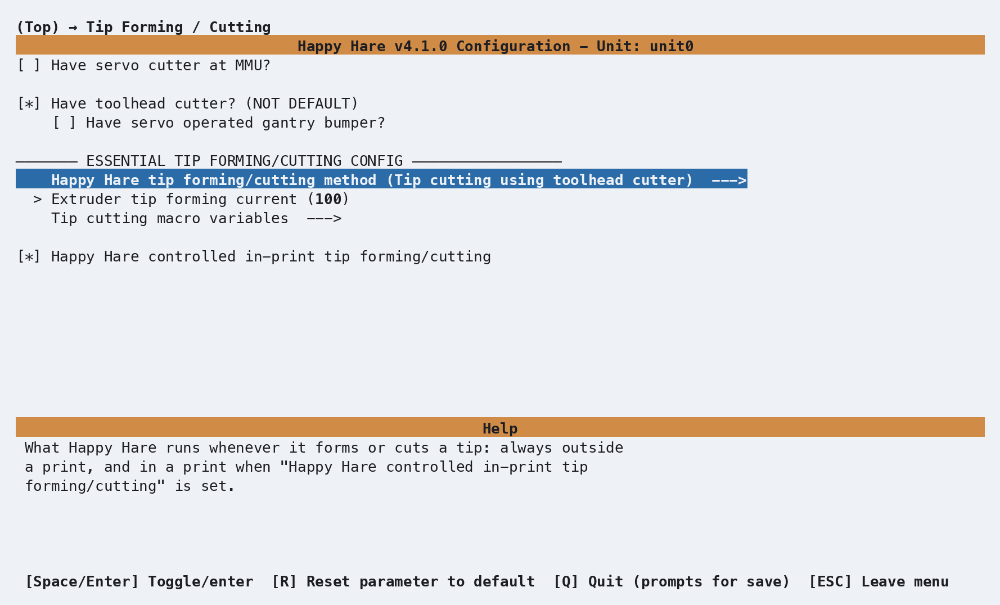
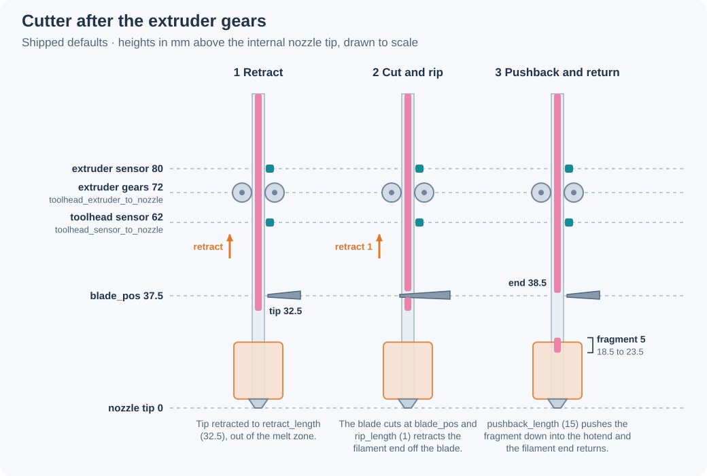
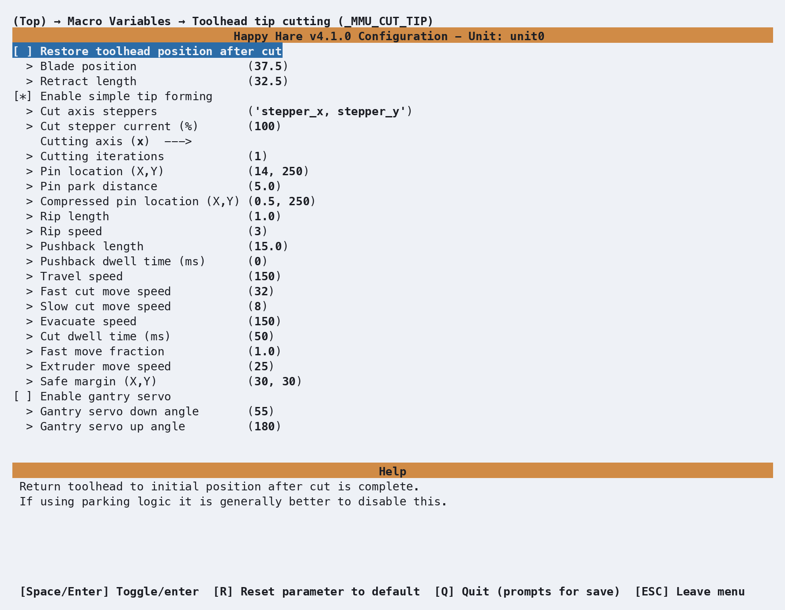
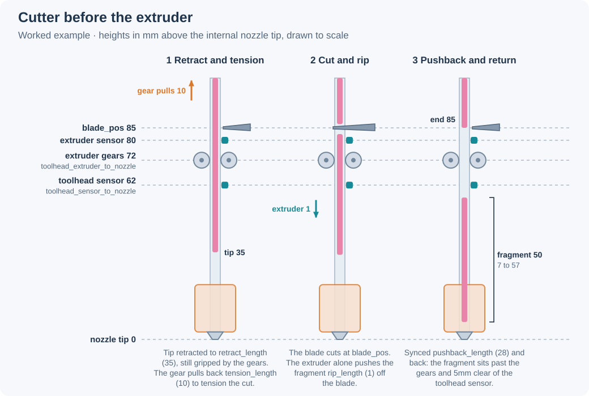

# Tip Shaping: Toolhead Cutting

## What it does

An alternative to filament-movement tip forming: a toolhead-mounted cutter
trims the tip cleanly instead, skipping the forming step (and its
per-filament tuning) entirely. See [Feature: Tip Forming and
Purging](Feature-Tip-Forming-Purging.md#toolhead-cutter-_mmu_cut_tip) for
the concept, trade-offs, and the cut routine itself - this page covers the
variables behind it. For worked toolhead-parking examples around a cutter
specifically, see [Toolchange Movement: Tip Cutting
Options](Toolchange-Movement.md#tip-cutting-options).

## Where it's applied

`_MMU_CUT_TIP`, defined in `mmu_cut_tip.cfg`. Active once
`form_tip_macro: _MMU_CUT_TIP` in `mmu.cfg`, which itself only becomes an
available choice once a toolhead cutter is enabled (**Toolhead
sensors/settings → Has toolhead cutter?** in menuconfig) - that's a
separate capability from the choice of tip-forming method itself.

## Selecting toolhead cutting

First enable **Has toolhead cutter?** under menuconfig's **Toolhead
sensors/settings --->** screen. Then open **Tip Forming / Cutting --->**,
open **Happy Hare tip forming/cutting method**, and choose **Tip cutting
using toolhead cutter**. This writes `form_tip_macro: _MMU_CUT_TIP` to
`mmu.cfg`.

<p align="center">
  
</p>

Leave **Happy Hare controlled in-print tip forming/cutting** enabled when
using the cutter, and disable the slicer's own tip forming. The optional
**Have servo operated gantry bumper?** setting appears with this method;
enable it and enter the servo pin only when the cutter is pressed against a
deployable gantry-mounted bumper. **Extruder tip forming current** can
temporarily boost the extruder from `100` to `150` percent during the cut
sequence; `100` disables the boost.

**Have servo cutter at MMU?** is a different, additive cutter at the MMU
end of the bowden. It is covered under [Tip Shaping: MMU
Cutting](Macro-Servo-Cutter.md).

## The cut sequence

With the blade after the extruder gears - between the gears and the
nozzle, the usual layout - a cut goes like this:

<p align="center">
  
</p>

1. **Retract.** The tip is retracted to `retract_length` above the nozzle,
   out of the melt zone. `simple_tip_forming` adds a short cooling move.
2. **Cut and rip.** The blade cuts at `blade_pos`, then a `rip_length`
   retract pulls the filament end off the blade so it can open again.
3. **Pushback.** `pushback_length` pushes the fragment down into the hotend
   and the filament end returns. The fragment is `blade_pos - retract_length`
   long and is purged by the next load.

If your blade is before the extruder gears instead, see [Cutter before the
extruder](#cutter-before-the-extruder).

### Cutting, loading and purging animation

Follow the same cutter-after-extruder example through the next load and purge.
Use **Play sequence**, step through with **Previous** and **Next**, or drag
the timeline. The active configuration settings appear below the toolhead.
The example adds a 2mm residual-filament allowance and a 2mm parking retract;
the melt and color transition are schematic, not a prediction of purge volume.
The animation uses a 2mm rip retract to make that small movement easier to see.

<div data-hh-animation="tip-cutting-purge">
  <p>The interactive sequence requires JavaScript. The cut sequence and static
  illustration above describe the same mechanism.</p>
</div>

<p><a href="Macro-Toolhead-Tip-Cutting/tip-cutting-purge.html" download="tip-cutting-purge.html" data-hh-animation-download>Download the animation</a>
as a self-contained HTML file in your current light or dark mode to open in a browser offline.</p>

## Configuration

<p align="center">
  
</p>

`_MMU_CUT_TIP_VARS` in `mmu_macro_vars.cfg`, reachable from menuconfig's
**Macro Variables → Toolhead tip cutting (\_MMU_CUT_TIP)** screen shown
above, once the capability flag above is on. Full variable table: [Macro
Variables: Toolhead tip cutting](Reference-Macro-Vars.md#toolhead-tip-cutting-_mmu_cut_tip_vars).
Tune the same one-variable-at-a-time way as tip forming (see [Feature: Tip
Forming and Purging](Feature-Tip-Forming-Purging.md#tuning-tip-forming)) -
the variables themselves just live in this different section.

A few settings are worth knowing about specifically:

- **`pin_loc_xy`**/**`pin_loc_compressed_xy`** are the depressor pin's real
  and fully-compressed X,Y coordinates - both toolhead-specific and not
  something to copy from another build.
- **`cutting_axis`** (`x` or `y`) and **`cut_axis_steppers`**/
  **`cut_stepper_current`** choose which axis the cut
  motion happens on, and an optional temporary current boost (up to ~150%)
  on the steppers doing the cutting move.
- **`cut_iterations`** repeats the cut - raise it if your cutter
  struggles with a particular filament.
- **`pushback_length`** pushes the cut fragment back into the hotend so it
  can't cause a future clog - a PTFE-tube-length-plus-a-few-mm starting
  point, not the couple of millimeters that might look sufficient at first
  glance. After the optional `pushback_dwell_time`, the pushing filament
  retracts by the same distance, leaving the cut fragment in the hotend.

!!! warning "Skew correction and cutter travel"
    The pin approach, cut strokes and return use `_SAFE_G1` to keep movement
    within axis limits. Corrections above 5 mm on any axis are rejected before
    movement. Smaller adjustments can still shorten the cut: this cap does not
    establish your cutter's mechanical tolerance. Verify that `pin_loc_xy`,
    `pin_loc_compressed_xy` and `pin_park_dist` leave enough travel at every
    print height. Check both endpoints with `MMU_CHECK_POSITION ... SKEW=<profile>`
    and consider `ERROR=1` checks in your start-print macro. See
    [Skew & Build Envelope](Skew-Build-Envelope.md).

Use [unload validation](Feature-Tip-Forming-Purging.md#unload-validation) to
warn about unexpectedly long sensor-clearing moves after a cut. Start with
`toolhead_unload_test: 1` and confirm the dimensions before using pause mode.

## Cutter before the extruder

Some toolheads only have room for the blade before the extruder gears - for
example the Qidi Plus4, Biqu H2 or Smart Orbiter 3. To use one, set
`variable_cutter_before_extruder: True` in `_MMU_CUT_TIP_VARS` ("Cutter is
before the extruder" in menuconfig). `blade_pos` must then be greater than
`toolhead_extruder_to_nozzle`, and Happy Hare reports an error at startup if
it isn't.

<p align="center">
  
</p>

### How the cut works

1. **Retract.** The tip is retracted to `retract_length` above the nozzle,
   as for any cut. It must still be past the gears, so the extruder grips
   what becomes the fragment.
2. **Tension.** The gear retracts `tension_length` while the extruder holds
   the tip, pulling the filament taut across the blade for a clean cut.
3. **Cut and rip.** After the cut, the extruder alone pushes the fragment
   `rip_length` off the blade. A cutter after the extruder gears retracts
   instead, but here that would pull the fragment back into the blade.
4. **Pushback.** A synced `pushback_length` push and return carries the
   fragment past the gears and leaves the filament end back at the blade.
5. **Unload.** Happy Hare checks the cut (below). The filament end has
   already left the extruder, so the bowden unload is shortened by
   `blade_pos - toolhead_extruder_to_nozzle`.

The fragment, `blade_pos - retract_length` long, stays in the toolhead.
The next load pushes it through the nozzle, and it's counted in the purge
volume.

### Checking the cut

A missed cut leaves the filament gripped by the extruder, and the bowden
unload would then grind it. So straight after the cut, Happy Hare checks it
with the first of these that's fitted:

| Fitted | Check |
|---|---|
| Extruder sensor between the blade and the gears | The sensor must already be clear |
| Extruder sensor before the blade | The gear must pull the filament clear of the sensor |
| Encoder | A short gear-only pull must move the filament |
| Sync-feedback buffer | A short gear-only pull must not put the buffer into tension |

A missed cut pauses before anything is pulled through the bowden. If none of
these is fitted the cut can't be checked, and the unload continues.
`MMU_STATUS SHOWCONFIG=1` shows which check is used.

### Worked example

This is the toolhead in the illustration above. Its dimensions come from
`[mmu_toolhead]` in `mmu.cfg`, plus `blade_pos` measured from the internal
nozzle tip:

| Dimension | Value |
|---|---|
| `toolhead_extruder_to_nozzle` | `72` |
| `toolhead_sensor_to_nozzle` | `62` |
| `toolhead_entry_to_extruder` | `8` (the extruder sensor is at 80) |
| `toolhead_residual_filament` | `2` |
| Toolchange retract (`park_toolchange`) | `2` |
| `blade_pos` | `85` |

1. **Clear the gears.** `pushback_length` must be at least
   `blade_pos - toolhead_extruder_to_nozzle + 3`: here 85 - 72 + 3 = 16mm.
   Any less, and a stub left in the gears would block the next load.
2. **Clear the toolhead sensor.** The pushback must also take the fragment
   past the toolhead sensor: more than `blade_pos - toolhead_sensor_to_nozzle`,
   which is 23mm. Choose `pushback_length: 28`, which leaves the fragment's
   top at 57mm, 5mm clear of the sensor.
3. **Leave room for the pushback.** The pushback can't be more than the
   retract left after the residual filament and the toolchange retract, so
   `retract_length` must be at least 28 + 2 + 2 = 32. It must also stay below
   72, so the tip is still gripped. A longer retract leaves a shorter
   fragment. Choose `retract_length: 35`.
4. **Keep the defaults** for `rip_length: 1` and `tension_length: 10`.
5. **Set `cutter_before_extruder: True`.**

```ini
[gcode_macro _MMU_CUT_TIP_VARS]
variable_blade_pos          : 85
variable_cutter_before_extruder : True
variable_retract_length     : 35
variable_pushback_length    : 28
variable_rip_length         : 1.0
variable_tension_length     : 10.0
```

That cuts a 50mm fragment, which ends up 7mm to 57mm above the nozzle. The
bowden unload is 13mm shorter. On the next load, the new filament homes to
the toolhead sensor and then moves 62 - 50 - 2 - 2 = 8mm, pushing the
fragment through to the nozzle.

!!! note "Checks on the pushback"
    If `pushback_length` or `retract_length` is too short to carry the
    fragment 3mm past the gears, Happy Hare reports an error at startup and
    `MMU_STATUS SHOWCONFIG=1` highlights it. The cut itself is then refused
    with a pause before the blade moves, so the filament is left whole.

### Limitations

- **Toolhead sensor.** The pushback must clear the toolhead sensor. If the
  fragment is still on it, the next load stops with "Possible toolhead
  sensor malfunction".
- **Without the MMU gear** (`MMU_UNLOAD EXTRUDER_ONLY=1` or bypass), the
  pushback can't carry the fragment past the gears, and only an extruder
  sensor before the blade can check the cut. Happy Hare warns you to clear
  the fragment by hand before the next load. During a runout it pauses
  instead, so EndlessSpool doesn't load the next filament into the
  fragment.
- **Blade calibration.** `MMU_CALIBRATE_TOOLHEAD CUT=1` can't measure
  `blade_pos` for this layout and refuses while `cutter_before_extruder` is
  set, so measure it by hand.
- **No-bowden MMUs.** On a no-bowden MMU (such as 3MS) whose gate endstop is
  the extruder sensor, a blade before that sensor leaves the filament end
  already past it. The unload then parks a few mm further back than
  usual; the next load homes to the same sensor.
- **Testing a missed cut.** To see the missed-cut check work, run one
  toolchange with the blade disabled.

## See also

- [Blobbing and Stringing](Blobbing-and-Stringing.md#calibrating-the-toolhead) -
  calibrate toolhead dimensions, residual filament and an after-extruder
  blade position before fine-tuning ooze; for a before-extruder cutter,
  use the manual blade measurement described above

- [Feature: Tip Forming and Purging](Feature-Tip-Forming-Purging.md#toolhead-cutter-_mmu_cut_tip) -
  concept, trade-offs, and the cut routine
- [Toolchange Movement: Tip Cutting Options](Toolchange-Movement.md#tip-cutting-options) -
  worked parking examples for a toolhead cutter
- [Macro Variables: Toolhead tip cutting](Reference-Macro-Vars.md#toolhead-tip-cutting-_mmu_cut_tip_vars) -
  every `_MMU_CUT_TIP_VARS` setting in full
- [Tip Shaping: Forming](Macro-Tip-Forming.md) - the default alternative this
  macro replaces
- [Skew & Build Envelope](Skew-Build-Envelope.md) - why the pin positions need
  margin with skew correction, and how to check them with `MMU_CHECK_POSITION`
- [Tip Shaping: MMU Cutting](Macro-Servo-Cutter.md) - a different, MMU-mounted
  cutter that trims *after* unload instead, additive rather than a
  replacement for either of the above

---
