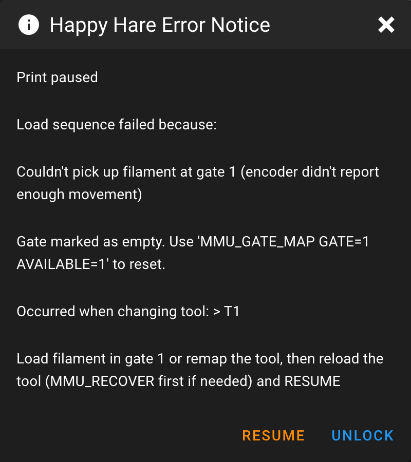

# Errors

This page lists the errors and warnings Happy Hare can report, what has
probably happened, and what to try. Use your browser's find (Ctrl+F) with a
few distinctive words from the message; values in `{braces}` below stand for
the gate, tool, sensor or distance in your message.

Messages from bad command arguments (`Invalid ...`, `... must have maximum
of ...`) and from Klipper itself are not listed individually: they name the
parameter or setting that is wrong.

## Reading an Error

### Where errors appear

Every error goes to the console in red, starting `!!`, and to `mmu.log`. What
else happens depends on when it occurs:

| When | Console shows | What happens |
|---|---|---|
| During a print | `MMU issue detected. Print paused` then `Reason: ...` | The print pauses, the toolhead parks and, with `show_error_dialog: 1`, the [pause dialog](Operation.md#the-pause-dialog) pops up. The nozzle heater turns off after `disable_heater` seconds. |
| While already paused | `MMU issue detected whilst printer is paused` then `Reason: ...` | Nothing new pauses. If the dialog was closed, it is shown again headed `Print is still paused`. |
| Outside a print | `MMU issue: ...` | The command stops. Nothing pauses, and a parked toolhead returns. |

A few problems are reported without stopping anything: these are marked
*warning* below. Some commands refuse to start instead, such as when
calibration is incomplete (see [Commands that refuse to run](#commands-that-refuse-to-run)).

### How a message is built up

Most errors from a toolchange, load or unload are wrapped, so the line you
look up is usually in the middle:

<div class="console-output codehilite"><pre><code><span class="console-error">!! MMU issue detected. Print paused
Reason: Load sequence failed because:
Couldn't pick up filament at gate 1 (encoder didn't report enough movement)
Gate marked as empty. Use 'MMU_GATE_MAP GATE=1 AVAILABLE=1' to reset.
Occurred when changing tool: &gt; T1</span>
Load filament in gate 1 or remap the tool, then reload the tool (MMU_RECOVER first if needed) and RESUME
</code></pre></div>

The same error in the Mainsail pause dialog:

<p align="center">
  
</p>

- **`Load sequence failed because:`** or **`Unload sequence failed because:`**
  says which half of a toolchange failed. Look up the line after it.
- **`Occurred when changing tool: T1 > T2`**, **`Occurred when loading
  tool`**, **`Occurred when unloading tool`** or **`Occurred during
  EndlessSpool swap of ...`** says what was being attempted. The dialog shows
  this line first.
- **The last line** is the advice, when the error has some. The dialog shows it
  as `Fix: UNLOCK to restore heating, then ...`. Advice usually ends with
  *then reload the tool (MMU_RECOVER first if needed) and RESUME*: `RESUME`
  continues the print but never reloads the tool itself, so get the filament
  where it should be first (see [State Recovery](Operation.md#state-recovery)).
- Some commands add their own prefix: `Filament preload for gate {g} failed:`,
  `Filament eject for gate {g} failed:`, `NFC scan for gate {g} failed:`,
  `Failure during check gate {g} (T{t}):`, `Calibration of ... failed.
  Aborting because:`, and `_MMU_STEP_...:` from [custom load/unload
  sequences](Custom-Load-Unload-Sequences.md).
- **`Klipper error: {message}`** is a Klipper error, such as `Move out of
  range`, that happened part way through an MMU operation in a print. It pauses
  like any other MMU error, and a toolchange is not retried. Outside a print
  the command just fails with Klipper's own message.
- **`Error running {MACRO}: {message}`** is an error inside a macro Happy Hare
  called, such as tip forming, purging or one of the `_MMU_PRE_*`/`_MMU_POST_*`
  hooks and their `user_*_extension`s. Fix the macro or its settings. Park,
  save and restore position macros only log this and carry on.

With `retry_tool_change_on_error: 1`, a toolchange that fails first logs
`... Retrying...` and recovers the filament position; only a second failure
pauses.

## Getting More Detail

The console shows the summary; `mmu.log` shows the steps that led up to it.
It is written next to Klipper's `klippy.log` (normally `~/printer_data/logs/`)
and starts a new file each day.

`log_file_level` sets how much goes into `mmu.log`, and `log_level` how much
reaches the console:

| Level | Name | Adds |
|---|---|---|
| `0` | Essential | Errors and essential messages only |
| `1` | Info | Normal progress (the console default) |
| `2` | Debug | Each step, measurement and decision (the `mmu.log` default) |
| `3` | Trace | Sensor readings, positions and internal state |
| `4` | Stepper | Every stepper move |

The default debug level is enough for most problems. If the cause still isn't
clear, raise the file level for the current session, then repeat what failed:

```text
MMU_TEST_CONFIG log_file_level=3
```

This lasts until Klipper restarts. To keep it, change **Log file (mmu.log)
level** in `menuconfig`, or `log_file_level` in `mmu.cfg`. When asking for
help, include `mmu.log`, `klippy.log`, the full error text and the output of
`MMU_STATUS SHOWCONFIG=1`.

## Hardware Key

The **Needs** column says which hardware or feature an error depends on; *any*
means it can happen on every MMU.

| Needs | Meaning |
|---|---|
| Encoder | A filament encoder (see [Encoder](Feature-Encoder.md)) |
| Gate sensor | The sensor used to home at the gate: `mmu_shared_exit`, a per-gate `mmu_exit`, or the extruder sensor on an MMU with no bowden |
| Entry sensor | A per-gate `mmu_entry` sensor where filament enters the MMU |
| Extruder sensor | The extruder entry sensor (`extruder`) before the extruder gears |
| Toolhead sensor | A sensor after the extruder entry, inside the toolhead |
| Buffer | A sync-feedback buffer (see [Sync-Feedback Buffer](Feature-Sync-Feedback-Buffer.md)) |
| FlowGuard | [FlowGuard](Feature-FlowGuard.md) clog and tangle detection |
| Linear selector | A selector driven along a rail to each gate, such as ERCF or Tradrack |
| Indexed selector | A rotating selector with an index switch per gate, such as BTT ViViD |
| Rotary selector | A rotary carriage that grips by position, such as 3D Chameleon |
| Servo selector | A selector positioned by a servo, such as PicoMMU or MMX |

Other entries name the feature: Blobifier, toolhead cutter, servo cutter,
filament bypass, EndlessSpool, NFC, TD-1, Spoolman, heater, eSpooler.

## Print Start

The start-of-print macros run in order: `MMU_START_SETUP`, `MMU_START_CHECK`,
your own `PRINT_START`, then `MMU_START_LOAD_INITIAL_TOOL` (see [Print
Start/End](Macro-Print-Start-End.md) and [Slicer Setup](Slicer-Setup.md)).
A pause during start-up lists the tools the print needs and offers `ABORT`.
An error in the slicer's parameters stops the print rather than pausing it.

| Message | Needs | What happened | What to try |
|---|---|---|---|
| `Happy Hare gcode pre-processor is probably disabled or not setup correctly` | any | *Warning.* The slicer's tool list arrived as the placeholder `!referenced_tools!`, so Moonraker didn't pre-process the file. Only the initial tool is gate-checked and the multi-color bypass check is skipped. | Enable the pre-processor in `[mmu_server]` (see [G-code Preprocessing](Feature-Gcode-Preprocessing.md)) and re-upload the file. |
| `Warning: Slicer defined extruder attributes have different lengths ...` | any | *Warning.* The slicer's color, temperature, material and name lists have different lengths. A temperature list shorter than the color list can also stop the print with an `unable to parse` error. | Check the slicer's start gcode passes every list to `MMU_START_SETUP`, as in [Slicer Setup](Slicer-Setup.md). |
| `Warning: Looks like slicer is setup with {n} extruders but your MMU has {g} gates! ...` | any | *Warning.* The slicer has a different number of filaments to the MMU's gates. Fewer is fine, especially with automapping. | If the slicer has **more** filaments than gates, the print stops (next row). |
| `Error on 'MMU_SLICER_TOOL_MAP ...': NUM_SLICER_TOOLS must have maximum of {g}` | any | The slicer defines more filaments than the MMU has gates, and the print stops. The warning before it says it will continue; it can't. | Reduce the slicer's filaments, or merge tools, to no more than your gate count. |
| `Error on 'MMU_SLICER_TOOL_MAP ...': INITIAL_TOOL must have maximum of {n}` | any | The slicer's first tool is beyond the last gate, and the print stops. | Fix the slicer's filament list or initial tool. |
| `Incorrect number of values for PURGE_VOLUMES ...` or `Error parsing PURGE_VOLUMES: ...` | any | The slicer's purge volume matrix is the wrong size or has a non-number in it, and the print stops. The expected counts shown assume one filament per gate. | Check the `PURGE_VOLUMES` placeholder in the slicer's start gcode. |
| `Error during automapping` followed by `... of tool {t} must be set ...`, `No gates found for tool {t} ...`, `No gate has a filament matching the desired material ...`, `Gates with {m} are missing color information...` or `Unable to find a suitable color for tool {t} ...` | any | With `automap_strategy` set, a tool the print uses couldn't be matched to a gate by name, material or color. Pauses (without the `ABORT` button). | Fill in the gate map (`MMU_GATE_MAP`, Spoolman or NFC) for the missing attribute, map the tool yourself with `MMU_TTG_MAP`, then `RESUME`. See [Gate/TTG Maps](Feature-Gate-TTG-Maps.md). |
| `Invalid automap strategy '{s}'` or `'spool_id' automapping strategy is not yet supported ...` | any | *Error, no pause.* `automap_strategy` isn't one Happy Hare supports, so no automapping happens. | Correct `automap_strategy` in `mmu_macro_vars.cfg`. |
| `Bypass selected for multi-color print` | Filament bypass | The bypass is selected and loaded, but the print uses more than one tool. | Unload the bypass, select or load the initial tool, then `RESUME`. Or `ABORT`. |
| `Load bypass or initial tool before resuming print` | any | Nothing is loaded and either the bypass is selected, or `MMU_START_SETUP` didn't run so the print's tools are unknown. | Load the bypass or the initial tool, then `RESUME`. If you expected `MMU_START_SETUP` to run, check the slicer's start gcode. |
| `Gate check completed with unavailable or unchecked gates:` followed by `Required Tool T{t} on gate {g} marked EMPTY` or `Gate {g} could not be checked: ...` | Gate sensor or Encoder | `MMU_START_CHECK` (with `check_gates: True`) found a gate the print needs empty, or couldn't check it. Every gate is checked before it pauses. | Load the gate, or remap the tool with `MMU_TTG_MAP`, or if the gate really has filament, `MMU_GATE_MAP GATE={g} AVAILABLE=1`. Then `RESUME`. See [MMU_CHECK_GATE](#gate-check) for the other messages it can give. |
| `Warning: Calibration steps are not complete for MMU {unit}:` | any | *Error, no pause.* The gate check or initial tool load refused to run because calibration is missing (see [below](#commands-that-refuse-to-run)), and the print carries on without it. | Cancel the print and finish the listed calibration steps. |
| `Unknown command:"T{n}"` | any | *Klipper message only.* The slicer used a tool number with no `T{n}` macro, so **no toolchange happened** and the print continues with the wrong filament. | Make the slicer's filament count match the MMU, or reduce it. |

Failures of the homing (`home_mmu: True`), gate check and initial tool load
appear in the sections below. A failure of the slicer's own start gcode, such
as `G28` in `user_pre_initialize_extension`, stops the print with Klipper's
message.

## Gate Pickup, Preload and Eject

| Message | Needs | What happened | What to try |
|---|---|---|---|
| `Couldn't pick up filament at gate {g} (gate endstop '{endstop}' didn't trigger)` with `Gate marked as empty ...` | Gate sensor | The gear motor drove for `gate_homing_max` (after `gate_load_attempts` tries) without filament reaching the gate sensor. The gate is now marked empty. | Check the spool has filament that reaches the gear, the gate isn't tangled, and the sensor works (`MMU_SENSORS`). Load the gate or remap the tool, then `MMU_GATE_MAP GATE={g} AVAILABLE=1` if needed. |
| `Couldn't pick up filament at gate {g} (encoder didn't report enough movement)` with `Gate marked as empty ...` | Encoder | The same, but homing to the encoder: the encoder didn't see filament move. | As above, and check the encoder is clean and calibrated. |
| `Couldn't pick up filament at gate {g} (...)` with `Filament position is uncertain. Check the path and recover before continuing.` | any | During `MMU_CHECK_GATE`, a gate failed to home, but something moved or a sensor sees filament, so it isn't simply empty. | Look at the gate's filament path, then `MMU_RECOVER` and try again. |
| `Cannot preload gate {g}: shared '{endstop}' path is already occupied (filament from another gate still loaded?)` | Gate sensor | The gate shares its homing sensor with other gates, and that sensor already sees another gate's filament. | Unload the other filament first (`MMU_UNLOAD`), or `MMU_RECOVER` if Happy Hare has the position wrong. |
| `Failed to unload {gate}: filament did not clear sensor '{endstop}' after moving {n}mm` (also `Failed to preload ...`) | Gate sensor | Parking at the gate, the filament never moved back past the gate sensor. | Check for filament stuck or tangled at the gate, or a sensor stuck on. |
| `Failed to unload {gate}: filament did not clear the encoder after moving {n}mm` (also `Failed to preload ...`) | Encoder | Parking at the gate, the encoder kept seeing movement, so the filament never left it. | Check for a tangle at the gate or the encoder wheel slipping. |
| `Filament did not exit gate homing sensor: {sensor}` | Gate sensor (per-gate `mmu_exit`) | Ejecting, the filament never cleared the gate's exit sensor. | Pull the filament back by hand and check the sensor. |
| `Attempting to load gate, but sensor '{sensor}' is not configured or is disabled` (also `unload`, `preload`) | Gate sensor | `gate_homing_endstop` or `gate_preload_endstop` names a sensor that is missing or turned off. | Re-enable it (`MMU_SENSORS`) or fix the setting. |
| `Attempting to load using encoder but encoder is not configured or is disabled` | Encoder | Gate homing is set to `encoder`, but the encoder is missing or disabled. | Check the encoder is configured and enabled, or choose a sensor for `gate_homing_endstop`. |
| `Unsupported gate homing endstop '{e}'` | any | `gate_homing_endstop` has a value Happy Hare doesn't recognize. | Fix it in `mmu_parameters.cfg`. |
| `Operation not possible: Can't crossload on this mmu type` | any | *Error, no pause.* You asked to preload, eject or scan another gate while one is loaded, and this MMU can't move two filaments at once. | Unload first. |
| `Operation not possible: Perhaps no exit sensors or filament still loaded` | any | *Error, no pause.* `MMU_PRELOAD` can't be used on this setup or while loaded. | Unload first, or load the gate normally. |
| `Filament detected by entry sensor on gate {g} but was not able to complete preload` | Entry sensor | *Warning.* The entry sensor sees filament but preloading it to the gate failed. The gate is marked unknown. | Push the filament a little further in, then `MMU_PRELOAD GATE={g}`. |

## Bowden

| Message | Needs | What happened | What to try |
|---|---|---|---|
| `Failed to load bowden from {gate}. Perhaps filament is stuck in the gate. Gear moved {n}mm, encoder measured {m}mm.` | Encoder | The encoder measured much less movement than the gear made, beyond `bowden_move_error_tolerance`. | Check the spool turns freely, the filament isn't snagged and the gear grips (servo or grip position). Check the bowden length and encoder calibration. |
| `Bowden pre-unload test failed. Filament appears to be stuck in the extruder or the filament was not loaded.` | Encoder | Before a full unload, a short pull back didn't move the encoder, so the filament is held in the extruder (a bad tip) or wasn't loaded. | Check the tip and nozzle, then `MMU_RECOVER`. If your tips are fine, consider `bowden_pre_unload_test: 0`. |
| `Warning: Excess slippage was detected in bowden tube load ...` | Encoder | *Warning.* The bowden load measured short even after correction moves. Details are in `mmu.log`. | Check the gear grip, the gate's rotation distance (`MMU_CALIBRATE_GATE`) and encoder calibration. |
| `Warning: Excess slippage was detected during bowden tube unload ...` | Encoder | *Warning.* The unload measured short. Parking at the gate deals with it. | As above. |
| `Warning: Possible sensor malfunction - {sensor} sensor indicated no filament present prior to unloading bowden.` | Gate sensor | *Warning.* A sensor before the bowden reads empty with filament loaded. | Check the sensor and its wiring (`MMU_SENSORS`). |
| `Warning: gate {g} not calibrated! Using default rotation distance` | any | *Warning.* The gate's gear rotation distance hasn't been calibrated. | `MMU_CALIBRATE_GATE GATE={g}` (with an encoder) or [calibrate the gear](Calibration-Gear.md). |
| `Warning: Restricting bowden load length to calibrated value of {n}mm` | any | *Warning.* A requested length was longer than the calibrated bowden. | Usually harmless. Recalibrate the bowden if it changed. |
| `Auto calibration is not possible with 'extruder_homing_endstop: none'` | any | The bowden isn't calibrated and there is no extruder homing point to calibrate it automatically. | Calibrate it with `MMU_CALIBRATE_BOWDEN` (see [Bowden Length](Calibration-Bowden.md)). |

## Extruder and Toolhead Loading

| Message | Needs | What happened | What to try |
|---|---|---|---|
| `Filament from {gate} did not reach extruder '{endstop}' endstop after moving {n}mm` | Extruder sensor, Buffer or Encoder | After the bowden move, homing to the extruder entrance didn't trigger within `extruder_homing_max`. | Check for a jam in the bowden or at the extruder entrance. If the bowden is longer than calibrated, recalibrate it or increase `extruder_homing_max`. |
| `The {endstop} sensor triggered before homing. Check filament and sensor operation` | Extruder sensor or Buffer | The extruder homing sensor already saw filament before the load reached it. | Clear the extruder path, check the sensor, then `MMU_RECOVER`. |
| `Cannot home to extruder using 'collision' method because encoder is not configured or disabled!` | Encoder | `extruder_homing_endstop: collision` needs an encoder. | Enable the encoder or choose a different `extruder_homing_endstop`. |
| `Possible toolhead sensor malfunction - filament detected before it entered the extruder.` | Toolhead sensor | The toolhead sensor reported filament before loading reached it. | Clear the toolhead, check the sensor (`MMU_SENSORS`), then `MMU_RECOVER`. |
| `Filament from {gate} did not reach the toolhead sensor after moving {n}mm` | Toolhead sensor | The extruder didn't pull the filament to the toolhead sensor within `toolhead_homing_max`. | Check the extruder gears gripped the filament and the toolhead path is clear. Check the filament tip shape. |
| `Move to nozzle failed (encoder didn't sense any movement) ...` or `... (encoder didn't sense sufficient movement) ...` | Encoder | The final move to the nozzle didn't move the encoder, or moved it too little (beyond `toolhead_move_error_tolerance`). The extruder probably didn't grip the filament. | Check the extruder gears gripped the filament, the tip is good and the nozzle isn't blocked. |
| `Failed to load filament passed the extruder entrance (sync-feedback buffer didn't detect neutral tension)` or `... (proportional sensor still compressed after {n}mm)` | Buffer, no toolhead sensor | With `toolhead_entry_tension_test` on, the buffer stayed compressed, so the extruder didn't take the filament. | Check the extruder grips (tension, tip shape). If loads are fine, turn the test off. |
| `Cannot load extruder because filament already in extruder (state: {n}). Unload first` | any | Happy Hare thinks filament is already in the extruder. | Unload first, or `MMU_RECOVER` if that is wrong. |
| `Warning: 80% of 'extruder_homing_max' was used homing ...` | any | *Warning.* Homing nearly ran out of distance. | Recalibrate the bowden or increase `extruder_homing_max`. |
| `Warning: Significant slippage was detected whilst homing to the extruder ...` | Encoder | *Warning.* Collision homing slipped. | Reduce `extruder_collision_homing_current`, or improve the gear grip. |

## Unloading

| Message | Needs | What happened | What to try |
|---|---|---|---|
| `Filament did not clear the extruder entry sensor after moving {n}mm` | Extruder sensor | Unloading, the filament never left the extruder: usually a bad tip or a jam. | Free the filament from the extruder (check the tip or the cut), then `MMU_RECOVER` and `RESUME`. Tune [tip forming](Macro-Tip-Forming.md) or [cutting](Macro-Toolhead-Tip-Cutting.md). |
| `Filament did not clear the toolhead sensor after moving {n}mm` | Toolhead sensor | As above, but the toolhead sensor still sees filament. | As above. |
| `Toolhead or extruder sensor failure. Extruder sensor reports no filament but toolhead sensor is still triggered.` | Extruder sensor and Toolhead sensor | The two sensors disagree at the start of the unload. | Check both sensors (`MMU_SENSORS`), and for a broken piece of filament in the toolhead. |
| `Warning: Toolhead sensor reports filament is still present in the toolhead, but the extruder sensor does not detect filament. Possible sensor malfunction.` | Extruder sensor and Toolhead sensor | This one **pauses**, despite saying warning. The filament cleared the extruder sensor but the toolhead sensor still sees some. | A broken piece of filament may be left in the toolhead. Check, then `MMU_RECOVER`. |
| `No encoder movement: Concluding filament is stuck in extruder` | Encoder and Toolhead sensor | Tip forming didn't move the encoder, so the filament didn't move. | Check for a clogged nozzle or filament stuck in the extruder. |
| `Cannot unload extruder because filament not detected in extruder! (state: {n})` | any | You asked to unload just the extruder, but Happy Hare thinks nothing is there. | `MMU_RECOVER` if that is wrong. |
| `Warning: Encoder not sensing any movement during final extruder retraction move ...` (or `sufficient movement`) | Encoder | *Warning.* Unloading continues, but the encoder didn't confirm the final retract. Often a sign of tip forming ejecting the filament completely, or a jam. | Watch the next unload; tune tip forming. |
| `Warning: Filament was not detected by the extruder (entry) sensor at the start of extruder unload.` (or `... by the toolhead sensor ...`) | Extruder sensor or Toolhead sensor | *Warning.* The sensor saw no filament at the start of the unload, and unloading continues. | Check the sensor; the position may have been wrong. |
| `Warning: Possible encoder malfunction (free-spinning) during final filament parking` | Encoder | *Warning.* The encoder moved when it shouldn't. | Check the encoder wheel and filament path. |

## Tip Forming, Cutting and Sequence Macros

Errors inside these macros appear as `Error running {MACRO}: {message}`.

| Message | Needs | What happened | What to try |
|---|---|---|---|
| `Filament tip forming macro '{m}' not found` | any | `form_tip_macro` names a macro that doesn't exist. | Fix `form_tip_macro` in `mmu_parameters.cfg`. |
| `Tip forming performed by slicer but 'slicer_tip_park_pos' not set` | any | *Error, no pause.* The slicer formed the tip but Happy Hare doesn't know where it was left. | Set `slicer_tip_park_pos` (see [Tip Forming and Purging](Feature-Tip-Forming-Purging.md)). |
| `Warning: output_park_pos was reported as 0mm ...`, `Warning: park_pos ({n}mm) cannot be greater than 'toolhead_extruder_to_nozzle' ...` or `Warning: Calculated filament remaining after cut is negative ...` | Toolhead cutter | *Warning.* The cut position the macro reported doesn't make sense. | Check the cutter macro's settings and `toolhead_extruder_to_nozzle` (see [Toolhead Cutting](Macro-Toolhead-Tip-Cutting.md)). |
| `Warning: Printer part fan is not defined. Ignoring 'toolchange_use_fan' option` | any | *Error, no pause.* Fan assist is on but there is no part cooling fan. The setting is `toolchange_fan_assist` in `mmu_macro_vars.cfg`. | Turn off `toolchange_fan_assist`, or set `toolchange_fan_name`. |
| `The value 'mmu_gantry_servo' is not valid for SERVO` | Toolhead cutter | The gantry servo is enabled but `[mmu_servo mmu_gantry_servo]` isn't configured. | Configure the servo or turn off `gantry_servo_enabled`. |
| `The value 'cut_servo' is not valid for SERVO` | Servo cutter | `[mmu_servo cut_servo]` isn't configured. | Configure the cutter servo (see [MMU Cutting](Macro-Servo-Cutter.md)). |
| `_SAFE_G1 {axis} adjustment {n}mm exceeds the 5mm limit; check macro positions, gcode offsets and skew compensation` | any | A park, cut or purge position is more than 5mm outside the printer's limits once gcode offset and skew are applied. In a park this only skips the move; in a pre-load, pre-unload or post-tip-forming park, a cutter or Blobifier it pauses. | Move the macro's coordinates inside the build volume. `MMU_CHECK_POSITION` checks a position. See [Skew & Build Envelope](Skew-Build-Envelope.md). |
| `Warning: Move to ({...}) adjusted to ({...}) to stay within axis limits ...` | any | *Warning.* The same, but less than 5mm out: the move was adjusted. Shown once per print. | As above. |
| `Warning: Klipper reported out of range gcode position ...` | any | *Error, no pause.* The saved toolhead position was outside the axis limits and was adjusted. | Check gcode offsets and skew compensation. |
| `Can't load - already in extruder!`, `Can't unload - already unloaded!` or `Can't unload extruder - already unloaded!` | Custom sequence | From the example [custom load/unload sequence](Custom-Load-Unload-Sequences.md) macros. | `MMU_RECOVER`, or fix your sequence macro. |
| `Error running _MMU_PARK: ...` (also `_MMU_SAVE_POSITION`, `_MMU_RESTORE_POSITION`, `_MMU_ERROR`, `_MMU_POST_PRELOAD`) | any | *Error, no pause.* The macro failed and Happy Hare carried on, so the toolhead may not have parked or returned. | Fix the macro settings named in the message. |
| `Cannot park because XY not homed` | any | *Message only.* The toolchange happens where the nozzle is. | Home before printing, or set `auto_home`. |

## Purging and Blobifier

| Message | Needs | What happened | What to try |
|---|---|---|---|
| `Empty purge bucket!` | Blobifier | The bucket holds `max_blobs`. | Empty the bucket, reset the count by removing and replacing the bucket (with a bucket switch) or with `_BLOBIFIER_COUNT_RESET`, then `RESUME`. |
| `BLOBIFIER: Not homed! Home xyz before blobbing` | Blobifier | *Message only.* **The purge was skipped** and the print continues, so the next color may be contaminated. | Make sure the printer is homed before toolchanges. |
| `BLOBIFIER: QGL not applied! run quad_gantry_level before blobbing` | Blobifier | *Message only.* As above, on a printer with `[quad_gantry_level]`. | Run `QUAD_GANTRY_LEVEL` in your print start. |
| `Please home (and QGL) before parking` | Blobifier | *Message only.* The toolhead wasn't parked on the tray. Also shown on printers without `[quad_gantry_level]`. | Home (and level) before printing. |
| `Blobifier has not been initialized. Run BLOBIFIER_INIT first` | Blobifier | Initialization at startup didn't finish, often because of a servo or stepper error. | Run `BLOBIFIER_INIT` and fix what it reports. |
| `Blobifier configuration is not defined for your printer` or `Blobifier is not correctly installed ...` | Blobifier | `purge_macro` is `BLOBIFIER` but Blobifier isn't installed, so no purging happens. | Re-run `./install.sh -i` and enable Blobifier, or change `purge_macro`. |
| `Shutdown due to BLOBIFIER: ...` | Blobifier | A Blobifier setting is out of range, and Klipper shuts down at startup. | Correct the setting named, then `FIRMWARE_RESTART`. |
| `The value 'blobifier' is not valid for SERVO` | Blobifier | The Blobifier servo isn't configured. | Check the Blobifier hardware config (see [Blobifier](Macro-Blobifier.md)). |
| `BLOBIFIER: No toolmap or PURGE_LENGTH. Using default` | Blobifier | *Message only.* The slicer didn't pass purge volumes, so the default `purge_length` is used. | Pass `PURGE_VOLUMES` to `MMU_START_SETUP`. |
| `Purge macro '{m}' not found` | any | *Warning.* `purge_macro` names a missing macro, so no purge happened. | Fix `purge_macro`. |

## Runout, Clog, Tangle and FlowGuard

These pause the print when the selected filament stops moving or runs out. See
[EndlessSpool & Runout Detection](Feature-Endless-Spool-Runout.md) and
[FlowGuard](Feature-FlowGuard.md).

| Message | Needs | What happened | What to try |
|---|---|---|---|
| `Runout detected on T{t} (gate {g}) by {sensor}` with `EndlessSpool mode is off - manual intervention is required` | Entry sensor, Gate sensor or Encoder | The filament ran out. | Load a new spool (`MMU_UNLOAD` the old filament first if needed), reload the tool, then `RESUME`. |
| `Runout detected on T{t} (gate {g}) by {sensor}` with `No alternative gates available ...` | EndlessSpool | The filament ran out and no other gate in the EndlessSpool group has filament. | As above, or load a gate in the group. |
| `Filament runout occurred at the extruder entry on T{t} (gate {g}). Manual intervention is required` | Extruder sensor | The filament ended or broke between the MMU and the extruder. | Find and clear the end, reload the tool, then `RESUME`. |
| `A clog has been detected on T{t} (gate {g}) by {sensor} and requires manual intervention` with `FlowGuard trip reason: Compression stuck after ...` | Buffer, FlowGuard | The buffer stayed compressed while the extruder should have been pulling: the nozzle or extruder isn't taking filament. | Check the nozzle and extruder for a clog. If it was a false trip, increase `flowguard_max_relief` (see [FlowGuard tuning](Feature-FlowGuard.md#tuning)). |
| `A tangle has been detected on T{t} (gate {g}) by {sensor} and requires manual intervention` with `FlowGuard trip reason: Tension stuck after ...` | Buffer, FlowGuard | The buffer stayed in tension: the filament is held back between the spool and the MMU. | Check the spool for a tangle or snag. |
| `FlowGuard detected a clog.` (or `tangle`) followed by `Reason for trip: ...` | Buffer, FlowGuard | The first line of a FlowGuard trip; the pause message follows. If the buffer sensor was disabled, FlowGuard turns off without pausing. | As above. |
| `A clog/tangle has been detected on T{t} (gate {g}) and requires manual intervention` | Encoder | The encoder stopped moving while the extruder printed, but filament is still there, so it is a clog or tangle rather than a runout. | Check the nozzle and extruder for a clog and the spool for a tangle. If false trips persist, see [Encoder](Feature-Encoder.md#tuning). |
| `Filament runout on an unknown or bypass tool` (or `clog`, `tangle`) | any | A runout or clog fired with the bypass or an unknown tool. Happy Hare can't swap spools here. | Fix it by hand, then `RESUME`. |
| `Filament runout/clog/tangle occurred but filament is marked as not loaded(?)` | Encoder | The encoder reported a runout while Happy Hare thinks nothing is loaded. | `MMU_RECOVER` to correct the position. |
| `Runout handler suspects sensor malfunction on {sensor} ...` (also `Insert handler`, `Remove handler`) | Entry sensor, Gate sensor or Extruder sensor | Reported as an assertion and ignored: the sensor changed back straight away. | Check the sensor and wiring for bounce. |
| `Espooler assist temporarily suspended because of suspected malfunction ...` | eSpooler | *Error, print continues.* The assist trigger stayed on too long. | Check the assist sensor isn't stuck (see [eSpooler](Feature-Espooler.md)). |

## EndlessSpool and Empty Gates

| Message | Needs | What happened | What to try |
|---|---|---|---|
| `Gate {g} is empty (and EndlessSpool on load is disabled)` | any | The tool's gate is marked empty. | Load the gate, remap the tool, or if it does have filament, `MMU_CHECK_GATE GATE={g}` or `MMU_GATE_MAP GATE={g} AVAILABLE=1`. |
| `Gate {g} is empty!` with `No alternatives gates available after checking for T{t} ...` | EndlessSpool | The gate is empty and no other gate in its group has filament. | Load a gate in the group, then `RESUME`. |
| `Gate {g} is empty! Checking for alternative gates ...` then `Remapping T{t} to gate {n}` | EndlessSpool | *Error, no pause.* The tool moves to another gate in its group and continues. | Nothing, unless the remap is wrong. |
| `A runout has been detected. Checking for alternative gates ...` | EndlessSpool | *Error, no pause.* The start of an automatic spool swap. | Nothing. |
| `{error}.` then `Occurred during EndlessSpool swap of T{t} (gate {g}) to gate {n}` | EndlessSpool | The automatic swap failed: look up the first line. | Fix that, reload the tool, then `RESUME`. |

## Selector and Servo

| Message | Needs | What happened | What to try |
|---|---|---|---|
| `Selector is not calibrated on {unit}` | Linear, Rotary or Servo selector | The selector positions haven't been calibrated. | [Calibrate the selector](Calibration-Selector.md). |
| `Selector is not homed on {unit}` | Linear or Rotary selector | The selector lost its position (motors off, a homing failure or a blockage). | `MMU_HOME`. |
| `Homing selector failed because of blockage or malfunction. Klipper reports: {message}` | Linear or Rotary selector | Homing the selector failed; Klipper's message says how. | Check nothing (such as filament in a gate) is in the way, the endstop works and the selector moves freely. |
| `Cannot home {unit} because it may have filament loaded. Unload filament first` | Linear or Rotary selector | Homing could tear filament that is still in a gate. | `MMU_UNLOAD`, then `MMU_HOME`. |
| `Cannot home {unit} because filament state or gate ownership is unknown. Use MMU_RECOVER GATE=xx first` | Linear or Rotary selector | Happy Hare doesn't know where the filament is. | `MMU_RECOVER GATE={g}`, then `MMU_HOME`. |
| `Selector touch operation detected blockage perhaps by filament in another gate or too much friction` | Linear selector with touch homing | The selector stopped part way to a gate. | Check for filament sticking out of another gate, and that the selector slides freely. |
| `Unblocking selector failed because unable to move filament to clear`, `Unblocking selector failed because: ...` or `Unblocking selector recovery failed. Path is probably internally blocked` | Linear selector with touch homing | Filament in the current gate blocked the selector and automatic recovery failed. | Clear the gate by hand, then `MMU_RECOVER` and `MMU_HOME`. |
| `Failed to locate selector index for gate {g}` | Indexed selector | The selector turned a full revolution without the gate's index switch triggering. | Check the index switch and its wiring. |
| `Extra endstop {unit}_gate{n} not defined on the selector stepper` | Indexed selector | An index switch is missing from the selector config. | Check `mmu_hardware.cfg`. |
| `Operation not possible because gate position is not calibrated` (also `release gate position`) | Rotary selector | *Error, no move.* The operation carries on without gripping or releasing. | `MMU_CALIBRATE_ROTARY_SELECTOR`. |
| `Operation not possible because selector gate angle is not calibrated` (also `release gate position`, `bypass angle is not configured`) | Servo selector | *Error, no move.* The operation carries on without moving the servo. | `MMU_CALIBRATE_SERVO_SELECTOR`. |
| `Selector doesn't allow or not configured to allow filament release` | `filament_always_gripped: 1` | *Error.* This MMU always grips the filament, so `MMU_RELEASE` does nothing. | Nothing to fix, or turn off **Filament always gripped?** if the design can release. |
| `MMU gear stepper could not be synced with extruder` | any | *Warning.* `MMU_SYNC_GEAR_MOTOR` couldn't sync: the selected gate couldn't be gripped (for example an uncalibrated servo gate), no gate is selected or the selector isn't homed. The sync request isn't kept. | Calibrate, `MMU_HOME` or `MMU_SELECT GATE={g}`, then retry. |
| `No servo fitted to selector on MMU {unit}` | any | `MMU_SERVO` on an MMU without a selector servo. | Nothing to fix. |
| `Warning: Selector angles not found in mmu_vars.cfg. Using configured defaults` | Servo selector | *Warning.* The servo selector hasn't been calibrated. | `MMU_CALIBRATE_SERVO_SELECTOR`. |
| `Error running {select_tool_macro}: ...` | Macro selector | *Error, no pause.* Your selector macro failed. | Fix the macro. |

## Gate Check

From `MMU_CHECK_GATE`, including the check during print start.

| Message | Needs | What happened | What to try |
|---|---|---|---|
| `Cannot check gate {g}: filament path is not safely unloaded.` | any | Filament is loaded, or the toolhead sensor sees some. | `MMU_UNLOAD`, or `MMU_RECOVER` if the position is unknown. |
| `Cannot check gate {g}: shared '{endstop}' path is occupied by another gate.` | Gate sensor | Another gate's filament is in the shared path. | `MMU_UNLOAD`, or `MMU_RECOVER` if the position is unknown. |
| `Gate {g} marked EMPTY` (or `... (no filament detected during homing)`) | Gate sensor or Encoder | *Message only.* No filament was found in the gate. In a print it becomes part of the pause below. | Load the gate. |
| `Gate {g} could not be checked: {message}` | any | *Message only.* The check failed before anything moved. | Look up the message. |
| `Failure during check gate {g} (T{t}):` followed by a message | any | Checking the gate failed after the filament moved. | Look up the message; `MMU_RECOVER` if the position is now unknown. |
| `Gate check completed with unavailable or unchecked gates:` | any | In a print, at least one gate the print needs is empty or unchecked. | See [Print Start](#print-start). |
| `Failure re-selecting Tool {t}:` | any | The check finished but the original tool couldn't be selected again. | Look up the message, then select the tool. |
| `Filament position is unknown. Use MMU_RECOVER to establish it` | any | After a failure that moved filament, Happy Hare doesn't guess where it is. | `MMU_RECOVER`. |

## Resume and Recovery

| Message | Needs | What happened | What to try |
|---|---|---|---|
| `Cannot resume because filament position not indicated as fully loaded (or unloaded).` | any | `RESUME` was refused: the filament is part way. | Finish loading or unloading, run `MMU_RECOVER` (`MMU_RECOVER LOADED=1` if it is loaded to the nozzle), then `RESUME`. |
| `Loaded check failed:` with `Filament not detected by sensors: {sensors}` | Gate, Extruder or Toolhead sensor | After a toolchange, load or `RESUME`, a sensor that should see filament doesn't. | Check the filament really reached the nozzle and the sensors work, then `MMU_RECOVER` and `RESUME`. |
| `Print is not paused. Resume ignored.` | any | *Message only.* `RESUME` while not paused. | Nothing. |
| `Filament detected but tool/gate is unknown. Please use MMU_RECOVER GATE=xx to correct state` | any | *Error, no pause.* At startup Happy Hare sees filament but not which gate it is from. | `MMU_RECOVER GATE={g}`. |
| `Filament not detected as either unloaded or fully loaded.` | any | *Error, no pause.* At startup the filament position is part way. | Check, then `MMU_RECOVER`. |
| `Filament appears to be in the bowden, but these sensors are not triggered: {sensors}` | Gate sensor | *Warning.* Recovery thinks filament is in the bowden but the sensors disagree. | Check the sensors and that the right gate is selected, then `MMU_RECOVER` again. |
| `Alert: Automatically heating extruder to ... temp ...` | any | *Shown in red so it isn't missed.* An operation needed the nozzle hot. | Nothing. |

## Calibration

| Message | Needs | What happened | What to try |
|---|---|---|---|
| `Calibration of bowden length on gate {g} failed. Aborting because:` followed by a message | any | `MMU_CALIBRATE_BOWDEN` failed. The message says why: a sensor already triggered, not reaching the extruder, or `All {n} attempts at homing failed`. | See [Bowden Length](Calibration-Bowden.md). |
| `The {endstop} sensor was not triggered at start of movement ...` | Gate sensor | Manual bowden calibration started without filament at the gate sensor. | Load the filament to the extruder gear by hand first. |
| `Did not home to gate sensor after moving {n}mm` | Gate sensor or Encoder | Manual bowden calibration couldn't find the gate on the way back. | Check the gate sensor. |
| `Calibration of encoder failed. Aborting, because:` or `Filament not detected in encoder. Ensure filament is available and try again` | Encoder | `MMU_CALIBRATE_ENCODER` failed or saw no filament. | Load filament past the encoder and try again (see [Encoder](Calibration-Encoder.md)). |
| `Warning: Encoder is not detecting the expected number of counts ...` | Encoder | *Warning.* The resolution is more than 20% from the expected value. | Check the encoder is clean and the wheel teeth are intact. |
| `Calibration for gate {g} failed. Aborting, because:` | Encoder | `MMU_CALIBRATE_GATE` failed. | Look up the message. |
| `Calibration ignored because it is not considered valid (>20% difference from reference gate {g})` | Encoder | *Warning.* The gate's result is far from gate 0's. | Check the gear grip on that gate and try again. |
| `Failed to reach toolhead sensor after moving {n}mm`, `Failed to home to toolhead sensor` or `Failed to reverse home to ...` | Toolhead sensor | `MMU_CALIBRATE_TOOLHEAD` couldn't find a sensor. | Check the sensors and that filament reaches them (see [Toolhead](Calibration-Toolhead.md)). |
| `Measurements did not make sense. Looks like probing went past the blade pos! ...` | Toolhead sensor, Toolhead cutter | Cutter calibration gave impossible results. | Don't hold the blade closed, and remove any cut filament from the extruder. |
| `Selector didn't find home position` or `Selector didn't find home position or distance moved ({n}mm) was larger than expected.` | Linear or Rotary selector | Selector calibration didn't reach the endstop. | Align the selector with gate 0, remove filament, check the endstop. |
| `Selector move measured {n}mm. More than the anticipated maximum of {m}mm. Save disabled` | Linear or Rotary selector | *Warning, not saved.* The MMU dimensions don't match the configured model. | Check the vendor, version and `cad_*` settings. |
| `You configured your MMU for {n} gates but I counted {m}! Please update 'num_gates'` | Linear selector | *Error, not saved.* Automatic calibration counted a different number of gates. | Fix `num_gates`, or check the calibration ran the full length. |
| `Failed to detect selector gate {g}` or `Failed to measure selector gate {g} endstop width` | Indexed selector | Index calibration didn't find a gate's switch. | Check that gate's index switch. |
| `Proportional (analog sync-feedback) sensor not found or not active ...` or `Sensor malfunction. Could not read valid ADC output ...` | Buffer (proportional) | `MMU_CALIBRATE_PSENSOR` can't read the sensor. | Set `analog_pin` in `[mmu_buffer]` and check the wiring. |
| `Warning: calibration did not find both compression and tension limits ...` | Buffer (proportional) | *Warning.* The sensor's range wasn't fully found. | Check `buffer_maxrange`, or run again with a larger `MOVE=`. |
| `Invalid configuration or options provided. Perhaps you tried COLLISION=1 without encoder ...` | any | No bowden calibration method is available. | Use a method your hardware supports. |
| `Sorry this feature requires a toolhead sensor` | Toolhead sensor | `MMU_CALIBRATE_TOOLHEAD` needs a toolhead sensor. | Set the toolhead distances by hand (see [Toolhead](Calibration-Toolhead.md)). |

## NFC, TD-1 and Spoolman

| Message | Needs | What happened | What to try |
|---|---|---|---|
| `NFC scan for gate {g} failed: {message}` | NFC | Moving the filament past the reader failed; the message says how. | Check the gate for a jam. See [NFC/RFID Reading](Feature-NFC.md). |
| `Could not home to the gate to start the NFC scan for gate {g} - is the filament loaded in the gate?` or `Could not reach the gate to establish a datum ...` | NFC | The scan couldn't find its starting point. | Make sure the gate is preloaded. |
| `could not re-park filament in gate {g} after scanning - check for a jam` | NFC | Parking after the scan failed. | Check the gate for a jam. |
| `Gate {g} has no NFC reader to scan`, `Gate {g} NFC reader is disabled ...` or `Operation not possible: No NFC reader configured for gate {g}` | NFC | The gate's reader is missing or turned off. | `MMU_NFC GATE={g} ENABLE=1`, or check the reader config. |
| `NFC: reader '{r}' did not respond during init` or `NFC: error initializing reader '{r}': ...` | NFC | The reader didn't answer at startup. | Check its wiring, address and power. |
| `NFC: read error on reader '{r}': ...` | NFC | *Error, no pause.* A read failed. | Usually a tag or wiring problem; try again. |
| `NFC: gate {g}: tag {uid} belongs to gate {n} and could not be moved out of the way ...` or `NFC: gate {g}: could not confirm this gate's own tag ...` | NFC | *Warning.* A neighboring gate's tag was in the reader's field, so the read was discarded rather than given to the wrong gate. | Follow the advice in the message. |
| `NFC: scanned tag ... is not registered against any spool in Spoolman` | NFC, Spoolman | *Error, no pause.* The tag was read but Spoolman doesn't know it. | Register the tag (`MMU_SPOOLMAN_TAG`). |
| `TD-1: Moonraker response timed out`, `TD-1: Moonraker bridge unavailable: ...` or `TD-1: scanner {s} is disconnected` | TD-1 | The TD-1 couldn't be reached through Moonraker. | Check the Moonraker `[td1]` component and the USB connection. See [TD-1](Feature-TD1.md). |
| `TD-1: no fresh measurement for gate {g}` | TD-1 | *Warning.* Filament passed the scanner but no reading arrived in time. | Try again; check the scanner. |
| `Error while ... spoolman ...` with `Moonraker/spoolman may not be configured (check moonraker.log)` | Spoolman | *Error, no pause.* A Spoolman request through Moonraker failed. | Check `moonraker.log` and the Spoolman settings (see [Spoolman](Feature-Spoolman.md)). |
| `Spoolman mode is 'pull': ...` or `Cannot use NEXT_SPOOLID feature with spoolman_support: pull ...` | Spoolman | *Error.* The change isn't allowed in `pull` mode. | Change the spool in Spoolman, or use `push` mode. |

## Heaters, Fans and eSpooler

| Message | Needs | What happened | What to try |
|---|---|---|---|
| `No MMU heater configured on {unit}` | Heater | `MMU_HEATER` on a unit without a heater. | Check the unit, or configure a heater (see [Heater & Environment Manager](Feature-Environment-Manager.md)). |
| `MMU already in filament drying cycle. Stop current cycle first` | Heater | A drying cycle is already running. | Stop the current cycle first. |
| `Exceeded max concurrent heaters` | Heater (per gate) | Too many gate heaters were asked to run at once. | Dry fewer gates at a time. |
| `MMU environment sensor not found. Check 'environment_sensor' configuration` | Heater | *Warning.* Drying needs an environment sensor. | Configure one. |
| `Warning: Gate {g} drying temperature {t}°C is greater than that recommended for {material} ...` | Heater | *Warning.* The requested temperature is above the material's recommended drying temperature. | Check the temperature and the gate's material. |
| `No manageable fans on this unit` | any | `MMU_FAN` on a unit without fans it controls. | See [Fans & Airflow](Feature-Fan-Control.md). |
| `Gate {g} is not empty so cannot rotate ...` | eSpooler | *Warning.* Drying with rotation needs the filament end out of the gate. | Remove the filament end from the gate and secure it to the spool. |

## Commands That Refuse to Run

These stop the command before it starts. Nothing pauses.

| Message | What to do |
|---|---|
| `Warning: Calibration steps are not complete for MMU {unit}:` followed by `Required:` and the `MMU_CALIBRATE_...` commands to run | Run the listed calibration. Lines under `Optional (handled by autocal/autotune)` don't stop anything. |
| `Operation not possible. MMU is disabled. Please use MMU ENABLE=1 to use` | `MMU ENABLE=1` |
| `Operation not possible. Printer is actively printing` | Wait for the print to finish or pause it. |
| `Operation not possible. MMU is currently using bypass. Unload or select a different gate first` | Unload the bypass or select a gate. |
| `Operation not possible. MMU selector is not homed` | `MMU_HOME` |
| `Operation not possible. Filament is loaded` or `... Filament is not loaded` | Unload or load first. |
| `Operation not possible. No MMU gate selected` | `MMU_SELECT GATE={g}` |
| `Operation not possible. Filament may be loaded or its state is unknown` | Unload, or `MMU_RECOVER`. |
| `No encoder fitted to {unit}`, `No sync-feedback buffer fitted to {unit}`, `No espoolers fitted` or `Spoolman support is currently disabled` | The command needs hardware or a feature this MMU doesn't have. |
| `No tool associated with gate {g}. Check tool-to-gate mapping with MMU_TTG_MAP` | Map a tool to the gate with `MMU_TTG_MAP`. |

## Startup and Configuration Errors

Most configuration mistakes stop Klipper starting and are shown by Klipper
itself, naming the section and option. A few to look out for:

| Message | What happened | What to try |
|---|---|---|
| `Looks like Happy Hare is not installed correctly - cannot find 'happy_hare_version' in klipper config` | Happy Hare's config files aren't included. | Re-run `./install.sh`. |
| `Calibration settings file (mmu_vars.cfg) not found ...` | The `[save_variables]` file is missing. | Check `[save_variables]` in `mmu_macro_vars.cfg`, and that it is defined only once. |
| `MMU requires [pause_resume] to work, please add it to your config!` | Klipper's `[pause_resume]` section is missing. | Add `[pause_resume]`. |
| `... has different number of entries than the number of gates`, `tool_to_gate_map has different number of values ...` | A per-gate list in the config has the wrong length. | Give one value per gate. |
| `Option '{option}' is not valid in section '{section}'` | Klipper doesn't recognize an option, often one retired from Happy Hare. | Re-run `./install.sh`, which removes retired options, or delete the line. |
| `Warning: Some persisted state was ignored because it contained errors:` | *Warning.* Saved state in `mmu_vars.cfg` didn't match the config, such as a gate count change. | Check the gate map and TTG map (`MMU_GATE_MAP`, `MMU_TTG_MAP`). |
| `Skipping autohome of {unit} because it may have filament loaded ...` | *Warning.* The selector wasn't homed at startup. | `MMU_RECOVER`, then `MMU_HOME`. |
| `Warning: filament_switch_sensor '{name}' found in printer configuration. ...` | *Warning.* A Klipper filament sensor may pause prints behind Happy Hare's back. | Remove it, or turn off its `pause_on_runout`. |
| `Happy Hare Assertion: ...` | An unexpected internal error; the details are in `mmu.log`. | Report it with `mmu.log` and `klippy.log`. |

## See also

- [What Happens When the MMU Pauses](Operation.md#what-happens-when-the-mmu-pauses) - the pause, the dialog and recovering
- [State Recovery](Operation.md#state-recovery) - `MMU_RECOVER` and the filament position
- [Debugging Problems](Operation.md#debugging-problems)
- [Command Reference](Reference-Commands.md) - every command named here
- [Config Parameters](Reference-Parameters.md) - every setting named here

---
